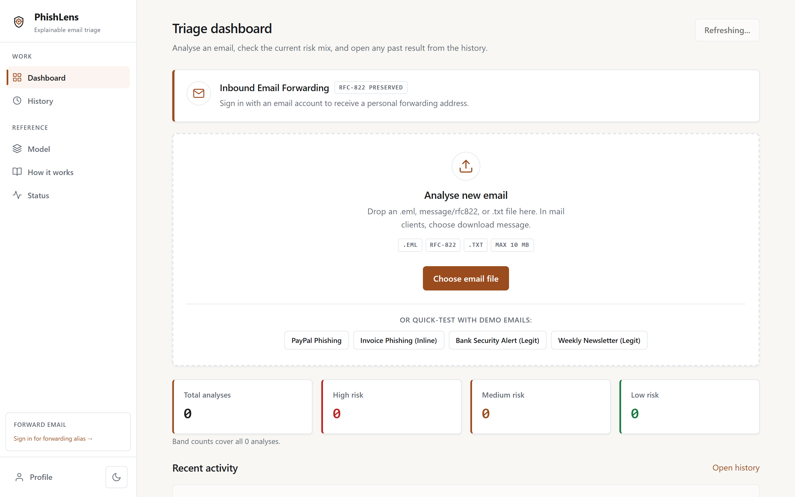
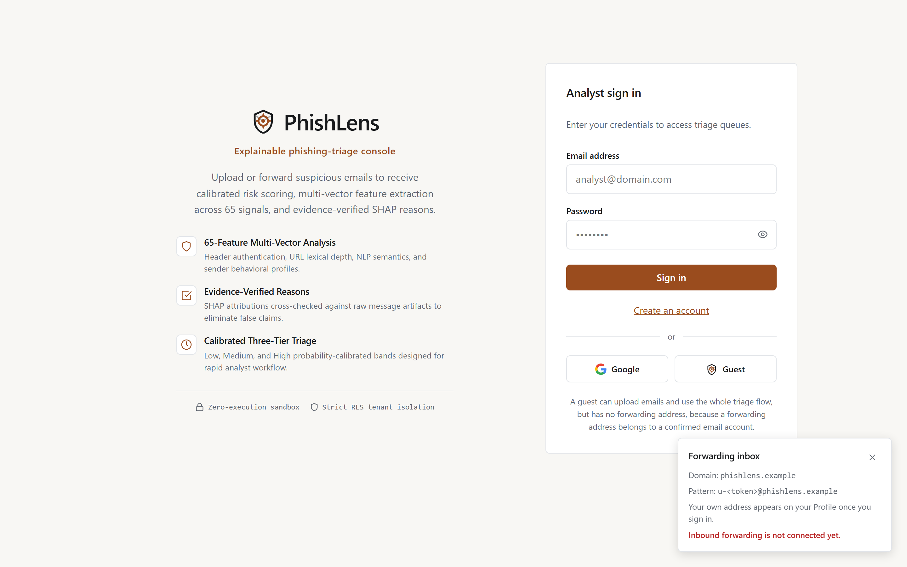

# PhishLens

**Explainable phishing detection by email forwarding.**
Forward a suspicious email to the PhishLens bot address; get a **Low / Medium / High** risk level and the
**plain-language reasons** behind it, in a web interface. Reasons come from **SHAP** feature contributions and are
**verified against evidence actually found in the email** before they are shown.

> Status: **v0.2.0** - a working end-to-end explainable triage system (parser -> 65 features across 6 groups -> model -> SHAP ->
> verified reasons -> API -> web UI) with 131 backend and 33 frontend unit tests, plus a Playwright smoke test. Inbound
> forwarding is active via Cloudflare Email Routing on `phislens.dpdns.org`. The released model is `xgboost-corpus-20261112-s7`,
> an XGBoost over the 65 features, fitted on modern mailbox mail, Nazario pre-2024 phishing, and Kaggle CEAS 2008 / 419 scam corpora.
> It measures a false-positive rate of 0.018 on held-out 2026 mail from that inbox, with phishing recall 0.770 and ROC-AUC 0.967.
> **Those numbers describe that combination and are not a general detection rate**: the feature set identifies the mail provider
> and the era with 0.981 accuracy, and the corpora span two decades. The caveats, the ablations and the measurements are in
> [docs/21-modern-corpus-evaluation-plan.md](docs/21-modern-corpus-evaluation-plan.md) and
> [docs/22-training-methodology-and-measurements.md](docs/22-training-methodology-and-measurements.md).

**New here?** [docs/SUMMARY.md](docs/SUMMARY.md) is the whole project in three minutes; every claim links to the
detailed page behind it.

## Interface Preview

### Triage Dashboard


### Explainable Analysis Detail & Verified Reasons


### Authentication & Forwarding Setup


## What is in this repository

| Path | What |
|---|---|
| `backend/` | FastAPI service: ingestion, 6 feature modules (65 features), model registry, SHAP, reason engine, risk bands, DB layer, tests, training scripts |
| `frontend/` | React + TypeScript (Vite) web UI: dashboard, history, analysis detail, model card, profile, status, Supabase login (email, Google, guest) |
| `supabase/migrations/` | PostgreSQL schema + Row-Level-Security policies |
| `docs/` | **All documentation**: project log, plan, architecture, design docs, decisions (ADRs), the project report (Markdown), Review-1 slide deck, diagrams |
| `scripts/` | `send_sample.py` (simulate the email webhook), `purge_old.py` (retention) |
| `docker-compose.yml`, `Makefile`, `.github/workflows/ci.yml` | run / build / CI |

Start reading at **[docs/README.md](docs/README.md)** (index). Short version: `01` overview -> `02` what was done and why ->
`03` plan -> `04` architecture -> the rest by topic.

## Quick start (local, no Docker)

Requirements: Python 3.11+ (CI and Docker use 3.12), Node 20+.

> Windows note: if `python` points to an older interpreter, create the virtual environment with
> `py -3.11 -m venv .venv` and run the commands through `.venv\Scripts\python.exe`.

```bash
# 1) backend
cd backend
python -m venv .venv && source .venv/bin/activate        # Windows: .venv\Scripts\activate
pip install -r requirements-dev.txt
python -m training.train --source synthetic --n 2400 --out models --reports reports --activate   # DEMO model, ~60 s
python -m pytest -q                                      # 131 pass, 1 skipped (needs Supabase creds)
python -m uvicorn app.main:app --reload --port 8000      # API docs: http://localhost:8000/docs

# 2) frontend (second terminal)
cd frontend
npm install
npm test                                                 # 33 Vitest tests
npm run test:e2e                                         # Playwright smoke (signed-in part needs E2E_EMAIL/E2E_PASSWORD)
npm run dev                                              # http://localhost:5173  (proxies /api to :8000)
```

### Windows shortcuts

From the repository root, the two scripts use the existing `.venv` and `node_modules`:

```powershell
.\backend.ps1    # API on http://localhost:8000
.\frontend.ps1   # UI on http://localhost:5173
```

`backend.ps1` refuses to start if `.venv` was built with Python older than 3.11, because the training code needs it.

Open http://localhost:5173, drop `backend/data/sample_emails/phish_paypal_direct.eml` on the upload box, and read the result.
Try the other samples too (legitimate newsletter, bank alert, an inline-forwarded invoice phish).

**Docker:** `cp .env.example .env && docker compose up --build` -> UI on http://localhost:8080, API on :8000
(Docker Desktop and WSL2 verified; container bakes the released model from `backend/release/model/`).

## Using real data (do this before reporting any result)

```powershell
cd backend
python -m training.download_datasets                  # Nazario phishing + SpamAssassin ham into data/raw
python -m training.download_kaggle                    # CEAS 2008 + Nigerian 419 scam corpora into data/raw/kaggle
python -m training.evaluate --out reports             # grouped-split metrics -> reports/evaluation.md
python -m training.train --source corpus --phish-dir data/raw/nazario --legit-dir data/raw/spamassassin --out models
python -m training.evaluate_modern --model-dir models # score on modern mail -> reports/modern/evaluation.md
```

`download_datasets` and `download_kaggle` fetch the corpora themselves (no manual download) and are rerunnable; `evaluate` trains a
throwaway comparator in memory and never touches the serving model in `backend/models/`. `training.train` writes a
candidate model directory and leaves `models/active` alone unless you pass `--activate`, so an offline run cannot
replace the serving model.

See [docs/datasets/README.md](docs/datasets/README.md) for provenance and split rules, and
[docs/08-ml-pipeline.md](docs/08-ml-pipeline.md) for the feature set, splits, behavioural benchmark, and evaluation plan.

## Inbound email forwarding

PhishLens supports automatic email forwarding via Cloudflare Email Routing:
1. Emails forwarded to `u-<token>@phislens.dpdns.org` are intercepted by Cloudflare.
2. The Cloudflare Worker `phishlens-inbound` delivers the raw RFC-822 message to `POST /api/webhooks/inbound`.
3. The backend authenticates the webhook secret, matches the recipient token to the user account, parses the message, extracts 65 features, and stores the analysis.
4. The user views the result in their Dashboard or History.

Detailed setup instructions are in [docs/23-cloudflare-email-forwarding.md](docs/23-cloudflare-email-forwarding.md).

## Important honesty notes

* The bundled demo model is trained on **generated** emails. Its metrics prove the plumbing works, **not** that phishing is detected.
* The released model is trained on combined corpora including modern mailbox ham. Held-out false-positive rate is 0.018 on that inbox, but format shortcuts identify corpus source with 0.981 accuracy. Do not present the model as general-purpose phishing detection. Evidence: [docs/21](docs/21-modern-corpus-evaluation-plan.md) and [docs/22](docs/22-training-methodology-and-measurements.md).
* Forwarding **inline** loses the original SPF/DKIM/DMARC results; the system treats them as *missing* (not failed). Users are instructed to forward **as attachment**.
* Sender-history ("unusual behaviour") features need trusted history; the bot only sees what users send it. See ADR-006 / ADR-007 in `docs/decisions/`.

