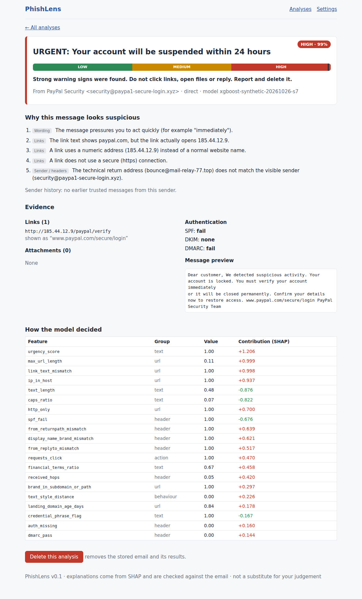

# PhishLens

**Explainable phishing detection by email forwarding.**
Forward a suspicious email to the PhishLens bot address; get a **Low / Medium / High** risk level and the
**plain-language reasons** behind it, in a web interface. Reasons come from **SHAP** feature contributions and are
**verified against evidence actually found in the email** before they are shown.

> Status: **v0.1 (initial version)** - a working end-to-end skeleton (parser -> six feature groups -> model -> SHAP ->
> verified reasons -> API -> web UI) with 30 passing tests. It ships with a **synthetic-data demo model for pipeline
> checks only**. Real corpora, real inbound-email provider, real domain-age lookups and the user study are still to do
> (see [docs/03-plan-and-roadmap.md](docs/03-plan-and-roadmap.md) and [docs/15-risks-and-limitations.md](docs/15-risks-and-limitations.md)).

BMSIT&M, Dept. of CSE - Mini Project (Batch 45), 2026-27 - Product Development category.



## What is in this repository

| Path | What |
|---|---|
| `backend/` | FastAPI service: ingestion, 6 feature modules (57 features), model registry, SHAP, reason engine, risk bands, DB layer, tests, training scripts |
| `frontend/` | React + TypeScript (Vite) web UI: dashboard, analysis detail, settings, optional Supabase login |
| `supabase/migrations/` | PostgreSQL schema + Row-Level-Security policies |
| `docs/` | **All documentation**: project log, plan, architecture, design docs, decisions (ADRs), the project report (Markdown), Review-1 slide deck, diagrams |
| `scripts/` | `send_sample.py` (simulate the email webhook), `purge_old.py` (retention) |
| `docker-compose.yml`, `Makefile`, `.github/workflows/ci.yml` | run / build / CI |

Start reading at **[docs/README.md](docs/README.md)** (index). Short version: `01` overview -> `02` what was done and why ->
`03` plan -> `04` architecture -> the rest by topic.

## Quick start (local, no Docker)

Requirements: Python 3.11+ (CI and Docker use 3.12), Node 20+.

> Windows note: if `python` points to an older interpreter, create the virtual environment with
> `py -3.11 -m venv .venv` and run the commands through `.venv\Scripts\python.exe`.

```bash
# 1) backend
cd backend
python -m venv .venv && source .venv/bin/activate        # Windows: .venv\Scripts\activate
pip install -r requirements-dev.txt
python -m training.train --source synthetic --n 2400 --out models --reports reports   # DEMO model, ~60 s
python -m pytest -q                                      # 30 tests
python -m uvicorn app.main:app --reload --port 8000      # API docs: http://localhost:8000/docs

# 2) frontend (second terminal)
cd frontend
npm install
npm run dev                                              # http://localhost:5173  (proxies /api to :8000)
```

Open http://localhost:5173, drop `backend/data/sample_emails/phish_paypal_direct.eml` on the upload box, and read the result.
Try the other samples too (legitimate newsletter, bank alert, an inline-forwarded invoice phish).

**Docker:** `cp .env.example .env && docker compose up --build` -> UI on http://localhost:8080, API on :8000
(first start trains the synthetic demo model automatically). *Docker was not available in the environment where
this repo was built, so the compose files are untested - see docs/12-deployment.md.*

For a local run without Docker, do not copy `.env.example`: the backend defaults to `sqlite:///./phishlens.db`.
If you create `backend/.env`, set `PHISHLENS_DATABASE_URL=sqlite:///./phishlens.db` (unless you want PostgreSQL).

## Using real data (do this before reporting any result)

```bash
python -m training.train --source corpus --phish-dir /data/nazario --legit-dir /data/spamassassin_ham --out models
```

See [docs/08-ml-pipeline.md](docs/08-ml-pipeline.md) (datasets, splits, behavioural benchmark, evaluation plan).

## Important honesty notes

* The bundled demo model is trained on **generated** emails. Its metrics prove the plumbing works, **not** that phishing is detected.
* Forwarding **inline** loses the original SPF/DKIM/DMARC results; the system treats them as *missing* (not failed). Ask users to forward **as attachment**.
* Sender-history ("unusual behaviour") features need trusted history; the bot only sees what users send it. See ADR-006 / ADR-007 in `docs/decisions/`.

## Team

Md Saquib Ali (1TE24CS174), N Sai Yashwanth Simha (1TE24CS178), Nakshatra Chaudhary (1TE24CS179), Mourya M Goankar (1BY24CS173). Guide: Dr. Shanthi D L.
