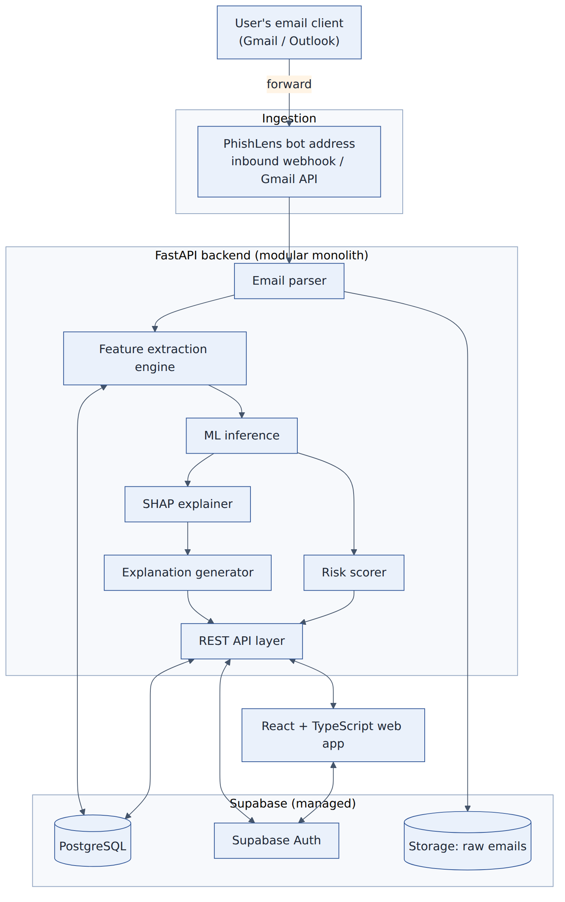
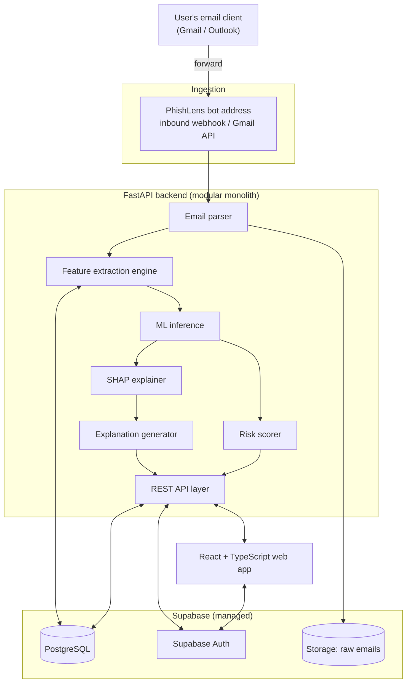
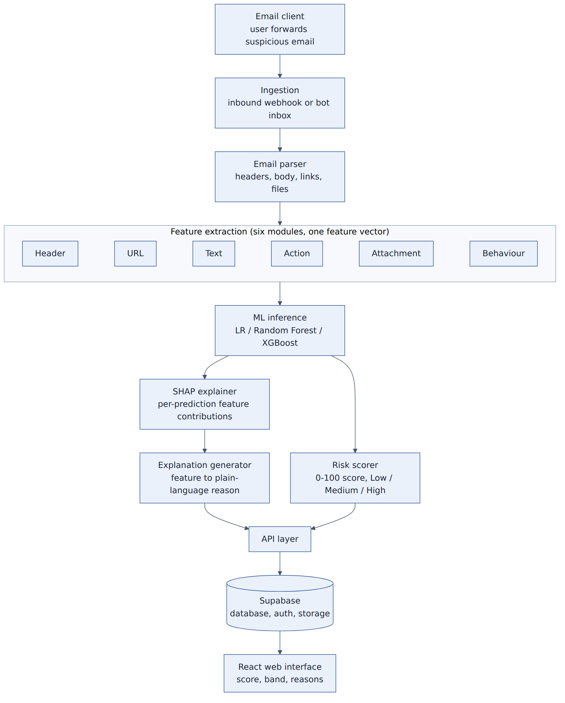
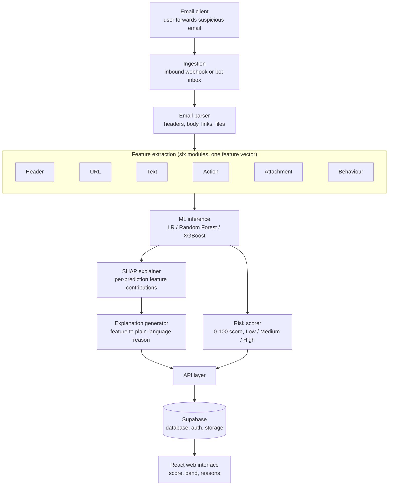
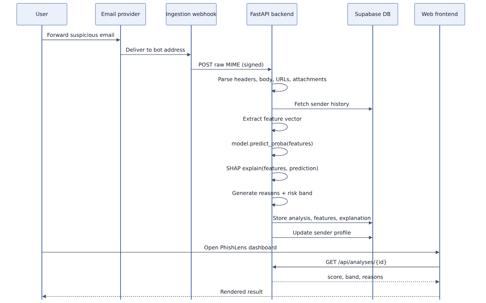
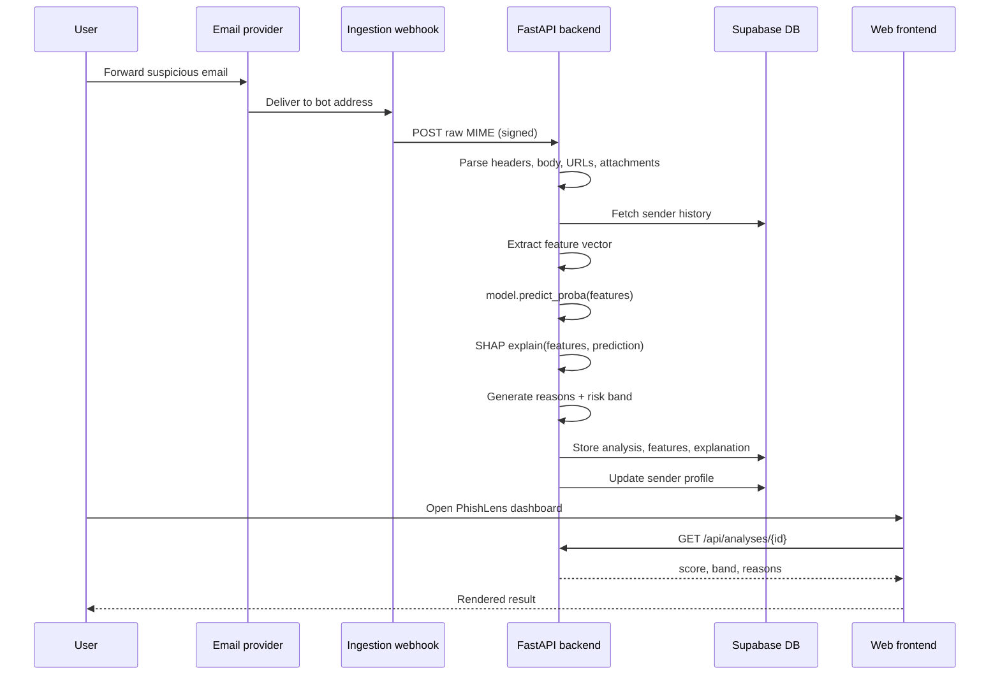
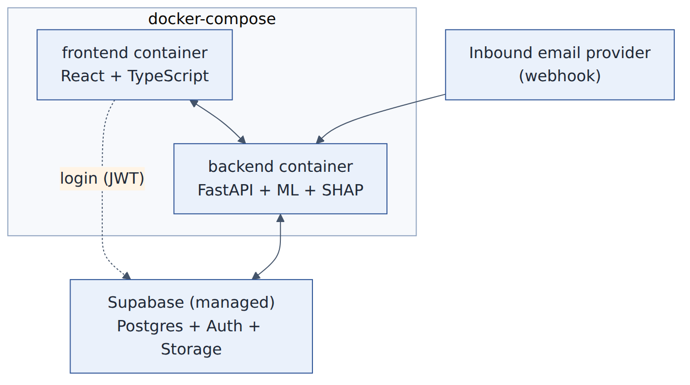

# 04 - Architecture

PhishLens is a **modular monolith**: one deployable FastAPI service whose internal modules have clear boundaries, plus a
managed Supabase backend and a React frontend. Any module can later be moved into its own service without rewriting the others.

## Design principles
1. **One workflow, no forms** - the only user action is forwarding an email.
2. **Explainability is structural** - SHAP output drives the explanation text; reasons are verified against extracted evidence.
3. **Train/serve parity** - `backend/app/features/` is imported by both the API and `training/`; feature logic exists once (ADR-003).
4. **Synchronous first, async-ready** - a queue can later sit between "received" and "processed" (ADR-004).
5. **Safe by default** - attachments are never opened; history is never learned from risky mail; unsupported statements are never shown.
6. **Honest about uncertainty** - missing evidence is encoded as *missing*, not as *bad*; weak cases get a generic reason, not an invented one.

## System context

Mermaid source

## Detailed processing pipeline

Mermaid source

## End-to-end sequence

Mermaid source

## Components and where they live in the repo

| Component | Responsibility | Code |
|---|---|---|
| Ingestion | receive forwarded mail (raw MIME or JSON), verify shared secret, map recipient alias -> user | `backend/app/api/webhooks.py` |
| Email parser | MIME -> headers, text, links (+anchor text), attachment metadata; detect forward-as-attachment / inline | `backend/app/ingestion/email_parser.py` |
| Feature engine | six modules -> 65 features + evidence | `backend/app/features/*.py` |
| Sender history | per (user, sender) rolling profile | `features/behavioral_features.py`, `db/repository.py` |
| Model registry | load `models/active/` (model, calibrator, background, meta) and check feature-set match | `backend/app/ml/registry.py` |
| SHAP engine | per-prediction contributions (Tree/Linear explainer) | `backend/app/explain/shap_engine.py` |
| Reason engine | 18 evidence-checked rules, selection rules, fallback | `explain/templates.py`, `explain/reasons.py` |
| Risk scorer | probability -> score -> band | `backend/app/scoring/risk_bands.py` |
| Pipeline | orchestrates everything and persists | `backend/app/services/analysis_service.py` |
| API | REST for the UI | `backend/app/api/analyses.py` |
| Database | SQLAlchemy models (SQLite / Postgres) | `backend/app/db/` , `supabase/migrations/0001_init.sql` |
| Web UI | dashboard, detail, settings, login | `frontend/src/` |

## Deployment view

## Forwarding behaviour (important)
* **Forward as attachment** -> original headers intact -> SPF/DKIM/DMARC usable.
* **Inline forward** -> the quoted header block is parsed for From/Reply-To/Subject/Date, but authentication results are
  unrecoverable -> features marked missing (`auth_missing = 1`).
* **Direct** (dev upload) -> analysed as the original.
