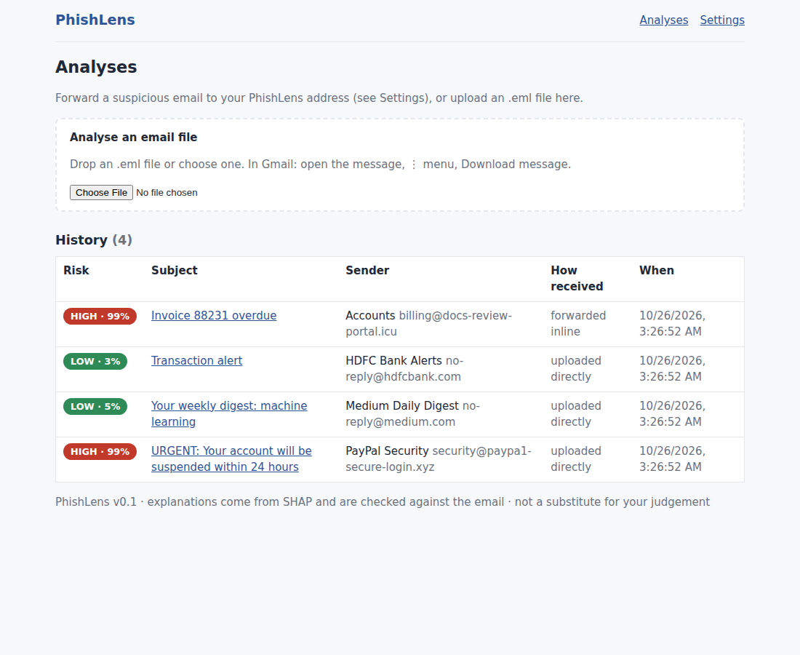
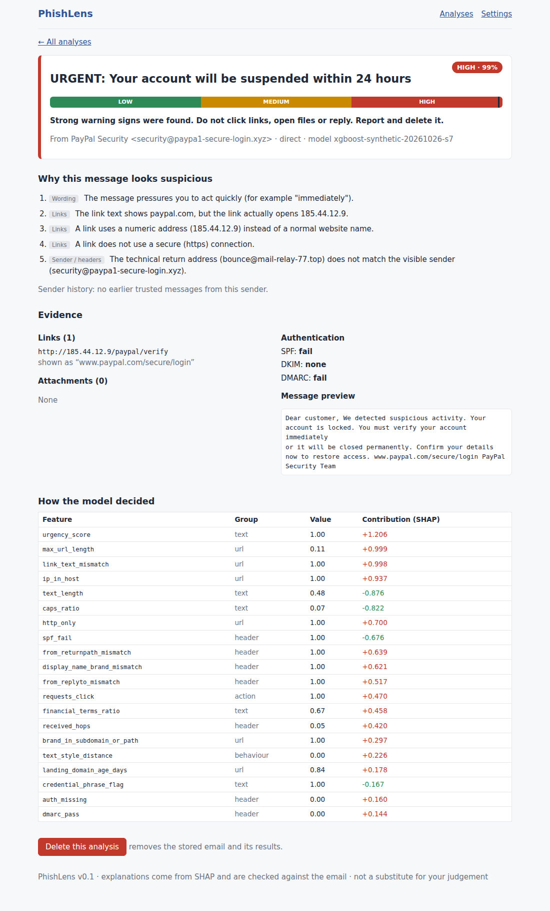
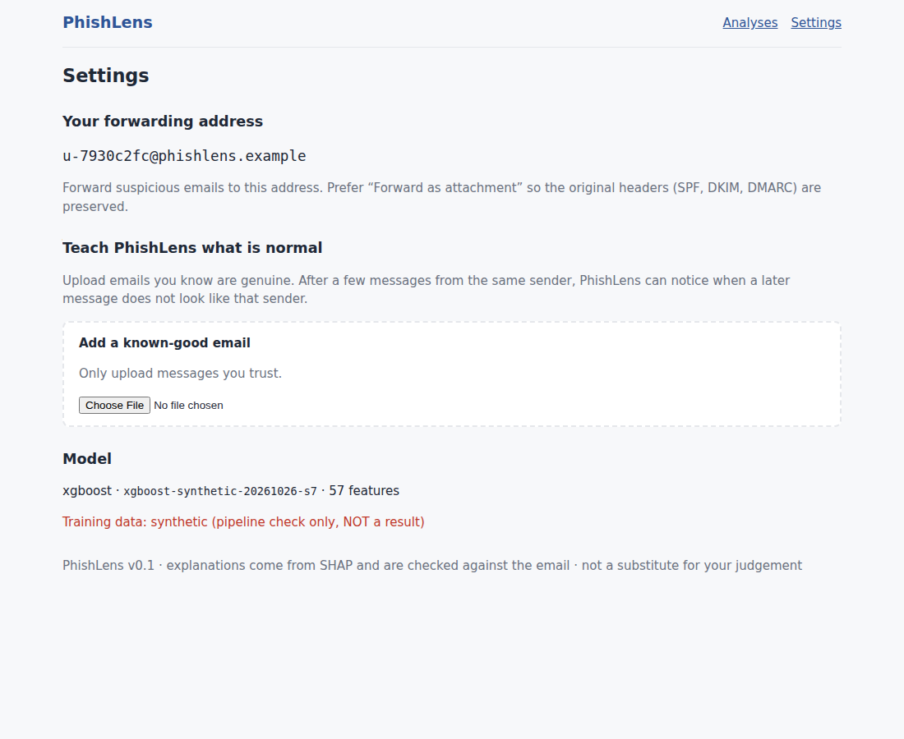

# 06 - Frontend design

React 18 + TypeScript + Vite; `react-router-dom`; optional `@supabase/supabase-js`. Source: `frontend/src/`. Builds with `npm run build` (type-check + bundle).

| Page | File | Shows |
|---|---|---|
| Analyses (dashboard) | `pages/Dashboard.tsx` | upload box (.eml), history table with band badge, subject, sender, how it was received, time |
| Analysis detail | `pages/AnalysisDetail.tsx` | band bar + score + guidance, **reasons** (tagged by evidence group), inline-forward notice, sender-history note, evidence (links with shown-vs-real, attachments, authentication, preview), optional SHAP feature table, delete |
| Settings | `pages/Settings.tsx` | personal forwarding alias, "known-good email" upload (sender history), active model info (warns if synthetic) |
| Login | `pages/Login.tsx` | Supabase email/password; hidden when auth is disabled |

* `api/client.ts` - typed fetch wrapper; adds `Authorization: Bearer <Supabase access token>` when Supabase is configured. In dev, Vite proxies `/api` to :8000 (no CORS); in Docker nginx does.
* LOW results are titled "Minor signals noticed", MEDIUM/HIGH "Why this message looks suspicious".
* The UI states plainly that explanations are checked against the email and that it does not replace the user's judgement.

## Screenshots (captured from the running app with the synthetic demo model)

Note: in the SHAP table, some features show contributions that look odd (e.g. a failed SPF with a negative contribution). That is a property of the *synthetic* demo
model (legitimate synthetic mail also fails SPF sometimes); it is exactly the kind of thing to examine with real data. Reasons only use risk-*raising* contributions.

## Next UI work
Reason wording review; "report as phishing / mark as safe" feedback buttons (also feeds sender history); history filters; mobile layout polish; accessibility pass;
Supabase password reset flow; browser add-on reuse of `api/client.ts`.
