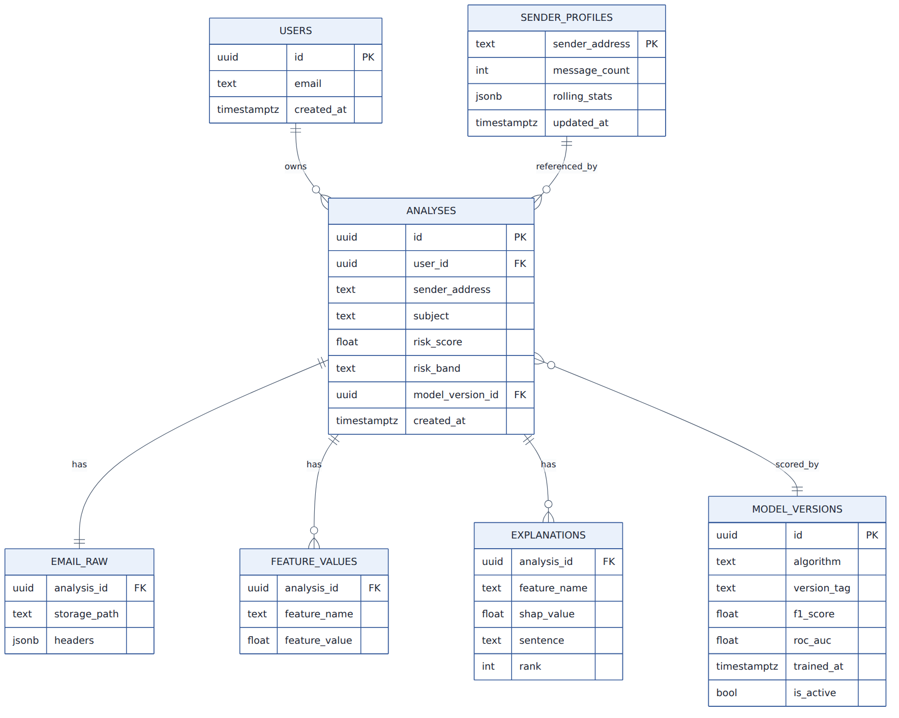

# 07 - Data model

Implemented in `backend/app/db/models.py` (SQLAlchemy), mirrored by `supabase/migrations/0001_init.sql` (with Row-Level-Security).

| Table | Purpose | Key columns |
|---|---|---|
| `analyses` | one row per analysed email | id, user_id, created_at, sender_address/name, subject, scope, forwarded_by, probability, risk_score, risk_band, model_version, auth (json), evidence (json) |
| `email_raw` | where the raw email is stored + parsed extras | storage_path, sha256, headers (json), text_preview (2000 chars), links (json), attachments (json: name, type, size, SHA-256) |
| `feature_values` | the 57 features and their SHAP contribution for this analysis | analysis_id, name, group, value, contribution |
| `explanations` | the displayed reasons | analysis_id, rank, rule_key, group, contribution, sentence |
| `model_versions` | models ever served | version_tag, algorithm, f1_macro, roc_auc, meta (json), trained_at, is_active |
| `sender_profiles` | per (user, sender) baseline | message_count, first/last_seen, stats (json: urgency mean/M2, domain sets, text centroid) |
| `user_aliases` | forwarding alias token per user | user_id, token |

Design notes
* `feature_values`/`explanations` are narrow name/value rows: adding a feature never needs a migration.
* `user_id` is the Supabase `auth.uid()` as text. RLS protects *direct client access*; the backend connects with its own credentials and enforces ownership in code (`_own`).
* Retention: raw files and rows are deleted after `PHISHLENS_RETENTION_DAYS` by `scripts/purge_old.py`; users can delete any analysis (file + rows).
* v0.1 creates tables with `Base.metadata.create_all`. Before real data exists, switch to Alembic migrations.
* Not stored: attachment contents, any credential, anything from MEDIUM/HIGH mail in sender history.
