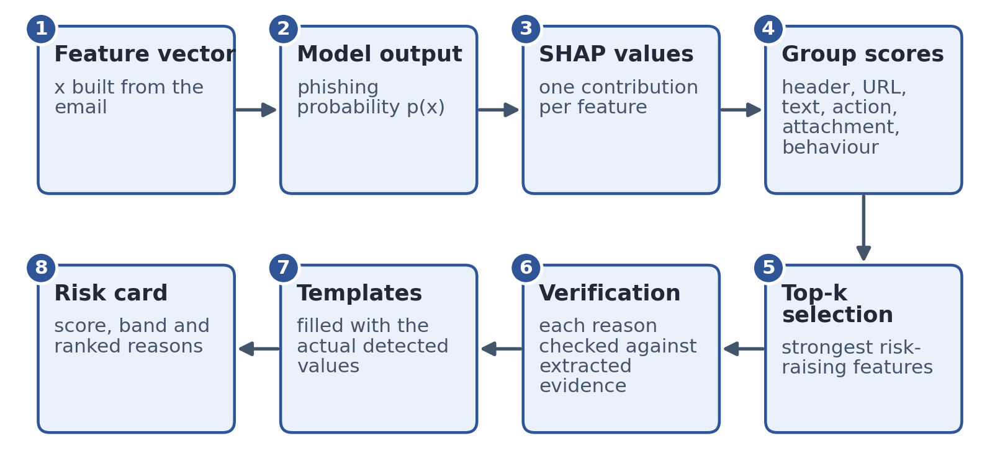

# 09 - Explainability

## What SHAP does here (and does not)
The model produces the probability. SHAP then attributes **that prediction** to its features (Shapley values; contributions add up to
`output - base value`) {Lundberg & Lee 2017; Tree SHAP: Lundberg et al. 2020}. SHAP is not the detector.
* XGBoost -> `TreeExplainer`, values in log-odds; Random Forest -> `TreeExplainer`, probability units; Logistic Regression -> `LinearExplainer` (needs the saved background sample).
* Positive values push towards phishing. Only the SHAP of the **phishing class** is used.

## From numbers to sentences (`explain/reasons.py`, `explain/templates.py`)

1. A **rule** groups features that tell one story (e.g. `auth_failed` = spf_fail, dkim_fail, dmarc_fail). Rule strength = sum of the **positive** contributions of its features.
2. Rules below `min_reason_contribution` (per model: 0.10 log-odds for XGBoost/LR, 0.02 probability for RF; stored in `meta.json`) are ignored.
3. **Verification:** each rule has a `check(values, evidence)` that returns format values only if the email's evidence supports the claim
   (e.g. a mismatching pair of domains really exists). If not, the reason is **discarded**. The model is never allowed to "say" something the email does not show.
4. Selection: at most one reason per evidence group first, then fill by strength; at most `top_k_reasons` (5); strongest first.
5. Templates are filled with the **real values** found in the message.
6. **Cold-start rule:** the behavioural reason is suppressed when `insufficient_history = 1`.
7. **Fallback:** MEDIUM/HIGH with no verifiable reason -> one generic sentence that claims nothing specific.

## Rule catalogue (18)
| Rule | Group | Example sentence |
|---|---|---|
| link_text_mismatch | url | The link text shows paypal.com, but the link actually opens 185.44.12.9. |
| auth_failed | header | The sender's domain could not be verified as authorised to send this message (SPF, DMARC failed). |
| replyto_mismatch | header | Replies would go to x@gmail.com, which is different from the sender address y@... |
| returnpath_mismatch | header | The technical return address (...) does not match the visible sender (...). |
| brand_display_mismatch | header | The sender name suggests Paypal, but the address belongs to paypa1-secure-login.xyz. |
| urgency | text | The message pressures you to act quickly (for example "immediately"). |
| asks_credentials / asks_payment / asks_download / asks_reply_info | action | The message asks you to enter or confirm your login or account details. |
| ip_in_host | url | A link uses a numeric address (185.44.12.9) instead of a normal website name. |
| shortener | url | A link uses a URL shortener (bit.ly), which hides where it really leads. |
| punycode | url | A link uses look-alike characters in its address (...). |
| brand_in_url | url | A link mentions Paypal but leads to x.top, which is not Paypal's website. |
| suspicious_tld | url | A link ends in an address type (x.top) that is often used for scams. |
| http_only | url | A link does not use a secure (https) connection. |
| young_domain | header | The website x was registered only 12 days ago. |
| risky_attachment | attachment | The attachment invoice.pdf.exe has a disguised double file extension. |
| behaviour_change | behaviour | This message differs from earlier messages from this sender: replies now go to ... |

## Why no LLM in v1 (ADR-005)
Cau et al. (2025, N=750) found LLM-written warning explanations about as protective as expert-written ones but warn that unconstrained generation can
hallucinate features; every sentence here is traceable to a detected feature, cheap and deterministic. Optional later: counterfactual wording
("this would look safer if the link text matched the real address") and LLM *rewording of already-verified facts*, still gated by the same checks.

## How to evaluate explanations (E7 + user study)
Deletion test (neutralise the top features -> probability should drop); stability of top reasons for near-identical emails; manual audit of 100 explanations
(true? understandable? misleading?); user study ([14-user-study.md](14-user-study.md)).
