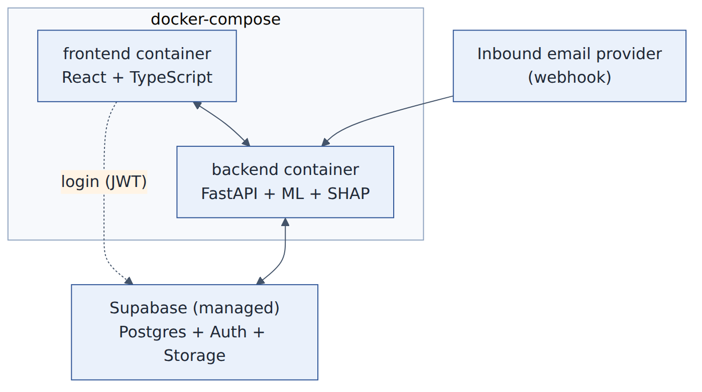

# 12 - Deployment



## Local (no Docker)
See the root README: `pip install -r backend/requirements-dev.txt`, train the demo model, run uvicorn on :8000, `npm run dev` on :5173.

## Docker Compose
`cp .env.example .env && docker compose up --build` -> UI http://localhost:8080 (nginx, proxies `/api` to the backend), API http://localhost:8000/docs.
`backend/entrypoint.sh` trains the **synthetic demo model** on first start when `PHISHLENS_AUTO_TRAIN_DEMO=true` (set in compose). Models, stored mail and the SQLite file live in named volumes.
**Not tested here** (no Docker engine in the build environment); the Dockerfiles are straightforward but expect small fixes on first run.
Disable auto-training and mount a real model directory for anything beyond demos.

## Render (free backend)
`render.yaml` defines one free Docker web service (`phishlens-api`) built from `backend/Dockerfile` with build context
`backend/`. The image trains the synthetic demo model at build time, so `/api/health` answers as soon as the container
starts instead of waiting on a cold-start training run. Shipping the corpora-trained model instead is a two-part
change (copy the model in the Dockerfile, set `PHISHLENS_AUTO_TRAIN_DEMO=false` in `render.yaml`) - see
`docs/19-teammate-training-guide.md` step 8, including the reason to think twice before doing it.

**Do not ship the corpora-trained model.** Measured on 2,216 messages from a modern inbox it flags 99.9% of
legitimate mail as phishing, because the only legitimate mail in the training corpora is SpamAssassin 2003. The
evidence, and the alternatives that would make a corpora-trained model shippable, are in
`docs/21-modern-corpus-evaluation-plan.md`. The synthetic demo model stays.

1. Render -> **New -> Blueprint**, pick the repository, apply. Render reads `render.yaml`.
2. When it asks for `PHISHLENS_DATABASE_URL`, paste the Supabase **Session pooler** URI. A bare `postgresql://`
   string is rewritten to `postgresql+psycopg://` at startup, so the Connect panel's copy-paste works unchanged. A raw
   `@` in the password is percent-encoded automatically: without that, libpq splits userinfo at the last `@` and the
   password ends up in the host name (`failed to resolve host '...@aws-0-...pooler.supabase.com'`). Passwords
   containing `#`, `?`, or `/` still have to be percent-encoded by hand.
   Render generates `PHISHLENS_WEBHOOK_SECRET` and `PHISHLENS_ADMIN_TOKEN` itself.
3. Note the service URL Render shows (`https://<service>.onrender.com`).
4. Set `VITE_API_BASE_URL` on the Vercel project to that URL and redeploy.

Free plan limits that matter: one instance, 512 MB RAM, 0.1 CPU, no persistent disk, and it sleeps after 15 idle
minutes (the next request waits roughly a minute for the wake). Measured peak RSS for one `/api/analyses/upload` call
on the demo model is ~257 MB, so 512 MB fits with headroom. Raw-email files in `storage/` are ephemeral; the analyses
themselves are rows in Supabase.

Rebuild the image locally with:
```powershell
docker build -f backend/Dockerfile -t phishlens-api backend
docker run --rm -p 8000:8000 phishlens-api
```
The container is public; never send real personal email to it, and expect the synthetic demo model's output, not a
security verdict.

## Vercel frontend (free)
`frontend/vercel.json` builds the Vite app and rewrites unknown paths to `index.html` so client routes such as `/cases`
work on refresh. Import the GitHub repository in Vercel, set **Root Directory** to `frontend`, and add
`VITE_API_BASE_URL=https://<backend-host>` plus `VITE_SUPABASE_URL` / `VITE_SUPABASE_ANON_KEY` as Production and Preview
environment variables. `VITE_API_BASE_URL` is read at build time, so changing it requires a redeploy.
On the backend, set `PHISHLENS_CORS_ORIGINS` to the exact Vercel origins (production domain first, preview domains if you
use them). `*` is rejected at startup because credentialed CORS would otherwise mirror any origin.

### Current frontend deployment

| Item | Value |
|---|---|
| Production URL | https://phishlens-gules.vercel.app |
| Vercel project | `phishlens` in team `yashwanth-creator02s-projects` (`team_Kgvgtk2aiYC50anZgBC0b94M`) |
| Root Directory | `frontend` |
| Environment variables | `VITE_SUPABASE_URL`, `VITE_SUPABASE_ANON_KEY`, `VITE_API_BASE_URL=https://phishlens-api-6esn.onrender.com` |
| Deployment protection | Vercel Authentication and password protection disabled so the URL is publicly reachable |
| Git auto-deploy | **not connected**; the Vercel GitHub App has no access to the private repo |

Deploy from the repository root, because `rootDirectory` is set on the project and the CLI resolves it relative to the uploaded tree:

```powershell
vercel deploy --prod --yes --scope yashwanth-creator02s-projects
```

`vercel link` writes `frontend/.vercel/` (gitignored) plus a `frontend/.env.local` holding a short-lived OIDC token; neither is committed.
Once the backend host exists, add `VITE_API_BASE_URL` to the Vercel project and redeploy; the build embeds it.
To restore push-to-deploy, install the Vercel GitHub App on `yashwanth-creator02/phishlens` and run `vercel git connect`.

## Supabase
1. Create a project. 2. Run `supabase/migrations/0001_init.sql` and `0002_auth_hardening.sql` in the SQL editor (tables + RLS). 3. Backend env: `PHISHLENS_DATABASE_URL=postgresql+psycopg://...` (install `requirements-postgres.txt`),
`PHISHLENS_AUTH_MODE=supabase`, and either `PHISHLENS_SUPABASE_JWT_SECRET=<Project Settings -> API -> JWT secret>` (HS256) or `PHISHLENS_SUPABASE_JWKS_URL=https://<project>.supabase.co/auth/v1/.well-known/jwks.json` (RS256/ES256). 4. Frontend build args: `VITE_SUPABASE_URL`, `VITE_SUPABASE_ANON_KEY`.
5. Raw email files: v0.1 writes to local disk (`storage/`); move to Supabase Storage (private bucket) before real use.
Postgres itself is still **not exercised in tests** (tests use SQLite). RLS isolation has a live-only contract test that skips without credentials; see `docs/11-security-privacy.md`.

### Current Supabase project

| Item | Value |
|---|---|
| Project ref | `vmbtdrmevlovvvfvtqmd` (display name `phislens`, region `eu-west-1`, PostgreSQL 17) |
| API URL | https://vmbtdrmevlovvvfvtqmd.supabase.co |
| Migrations | `0001_init.sql` then `0002_auth_hardening.sql` applied; 7 tables, RLS enabled on all of them |
| Frontend keys | anon (legacy JWT) and `sb_publishable_...` both available; the deployment uses the anon JWT |

Still manual in the dashboard: **Authentication -> URL Configuration** (Site URL
`https://phishlens-gules.vercel.app` plus a redirect allow-list for the same host) and, for a demo that works without
mail delivery, **Authentication -> Providers -> Email -> Confirm email** off (otherwise every signup needs a
confirmation mail that Supabase's built-in SMTP rate-limits). The app has no sign-up screen, so demo accounts are
created in **Authentication -> Users -> Add user** with **Auto Confirm User** ticked. The backend needs the database
password or pooler connection string for `PHISHLENS_DATABASE_URL`; the MCP connection cannot read it.

## Inbound email
Choose a provider that can deliver inbound mail to a webhook (Postmark inbound, Mailgun routes, SendGrid inbound parse, Cloudflare Email Routing + Worker). Point the bot domain's MX at it, set the webhook URL to
`https://<backend>/api/webhooks/inbound` and the shared secret. Write an adapter if the payload is not raw MIME. Gmail API push (OAuth + Pub/Sub) is the later alternative (ADR-002).

## Hosting options (provider not fixed)
Free tiers are the constraint, not the tooling. Hugging Face is out: custom Docker Spaces need a paid plan, and ZeroGPU
Spaces need an account at least 30 days old (both rejected with HTTP 402 on this account). Render's free web service
needs no card, runs the same Dockerfile, and is the current choice. Alternatives: Railway / Fly.io (both want a card),
Koyeb (512 MB, sleeps after an hour), or one VM with Docker Compose + Caddy for TLS (cheapest, most control). CI:
`.github/workflows/ci.yml` runs backend tests and the frontend build; add an image-build/deploy job once a host is chosen.

## Scaling and the async path
Watch p95 time from "webhook received" to "analysis stored". If SHAP + inference exceed a few seconds under load: webhook enqueues (Redis) and returns 202; a Celery worker runs `analyze`; the UI polls or subscribes via Supabase Realtime. No feature/model/explanation code changes.
