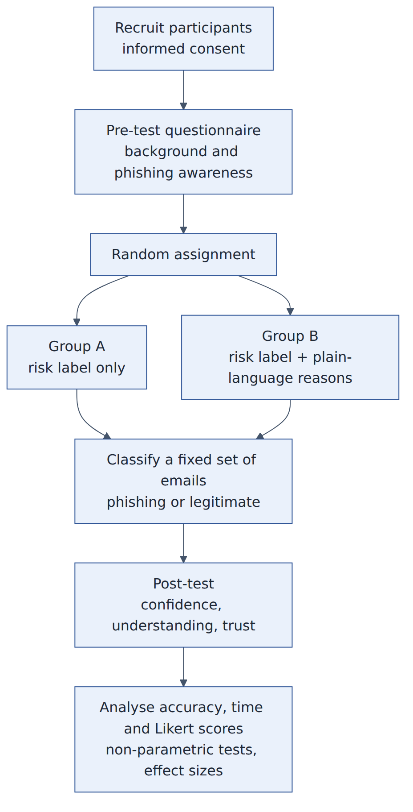

# 14 - User study (Objective 5)

**Question:** do plain-language reasons help people identify phishing emails better than a risk label alone?

* **Design:** between-subjects. Group A sees the risk label only; Group B sees label + reasons. Random assignment.
* **Participants:** students (aim >= 30-40), informed consent, no personal data collected beyond a short background questionnaire.
* **Materials:** a fixed set of 20-30 emails (balanced phishing/legitimate, including fluent LLM-style phishing and confusable legitimate mail), shown in a sandbox (links disabled). Labels/reasons come from the final system (or fixed so that all participants see the same).
* **Pre-test:** background and phishing awareness. **Task:** classify each email (phishing/legitimate) and give confidence. **Post-test:** understanding of the reasons, trust, usefulness (Likert), free comments.
* **Measures:** accuracy, false-positive/false-negative choices, time, confidence, Likert scores.
* **Analysis:** non-parametric tests (Mann-Whitney), effect sizes, 95% CIs; report null results honestly. Hypothesis (from the literature: Wagner et al. 2025 reported +10.1% accuracy for an explainable nudge): Group B more accurate by about 10 percentage points. This is a **hypothesis**, not a result.
* **Ethics/practicalities:** obtain approval from the guide/department; consent form; tell participants no real credentials are involved; keep data anonymous; pilot with 3-5 people first.
* **Reading list:** Wagner et al. 2025; Roy et al. 2025 (PhishXplain); Cau et al. 2025; Greco et al. 2023 (see references.md).
