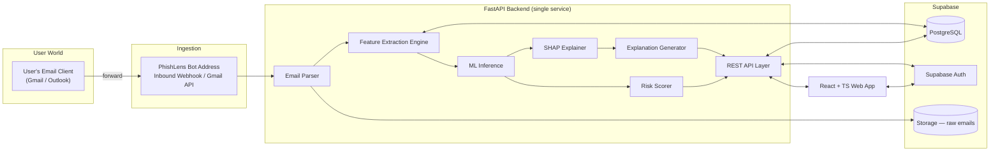
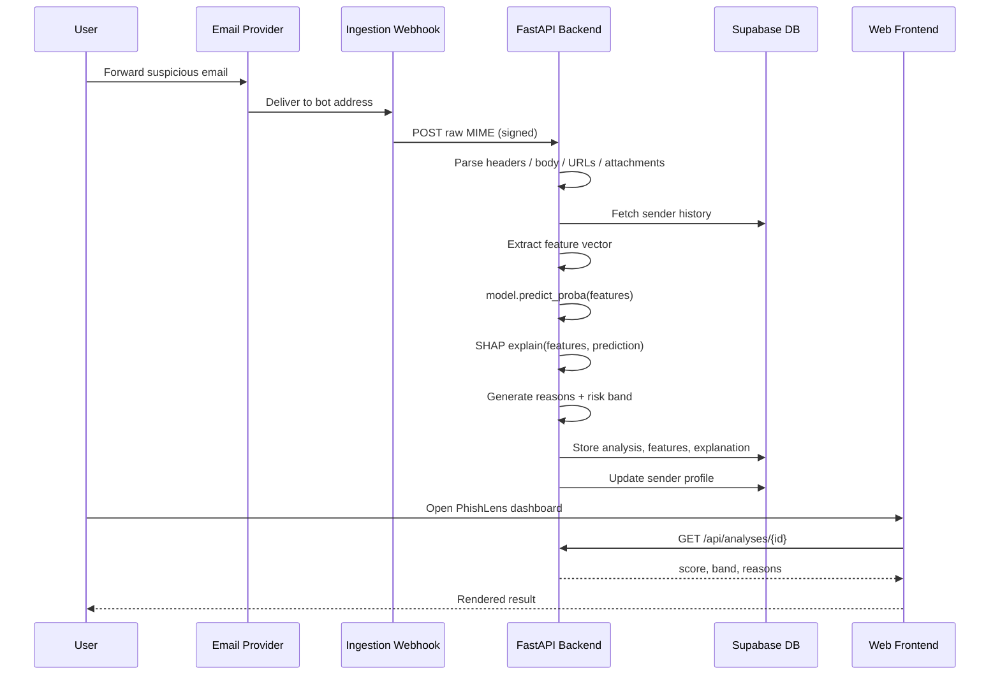
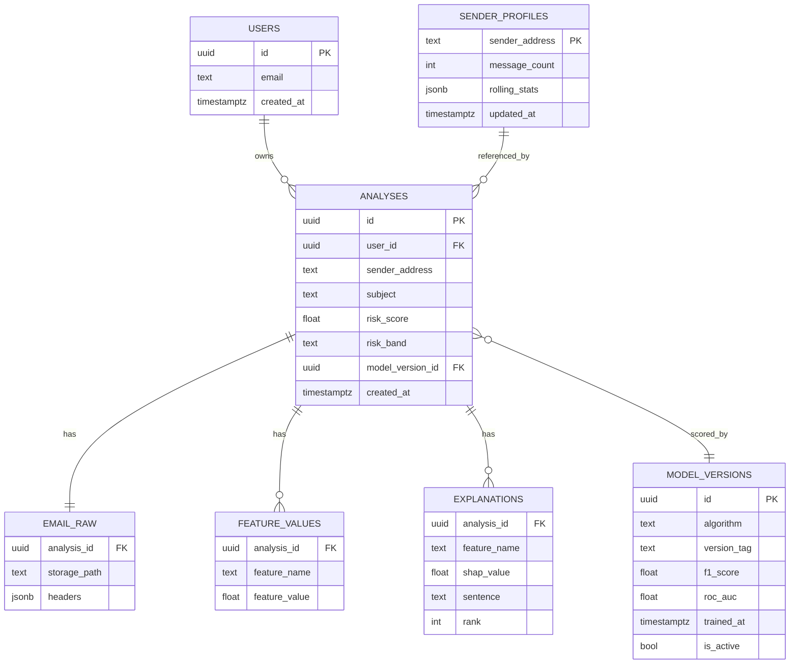
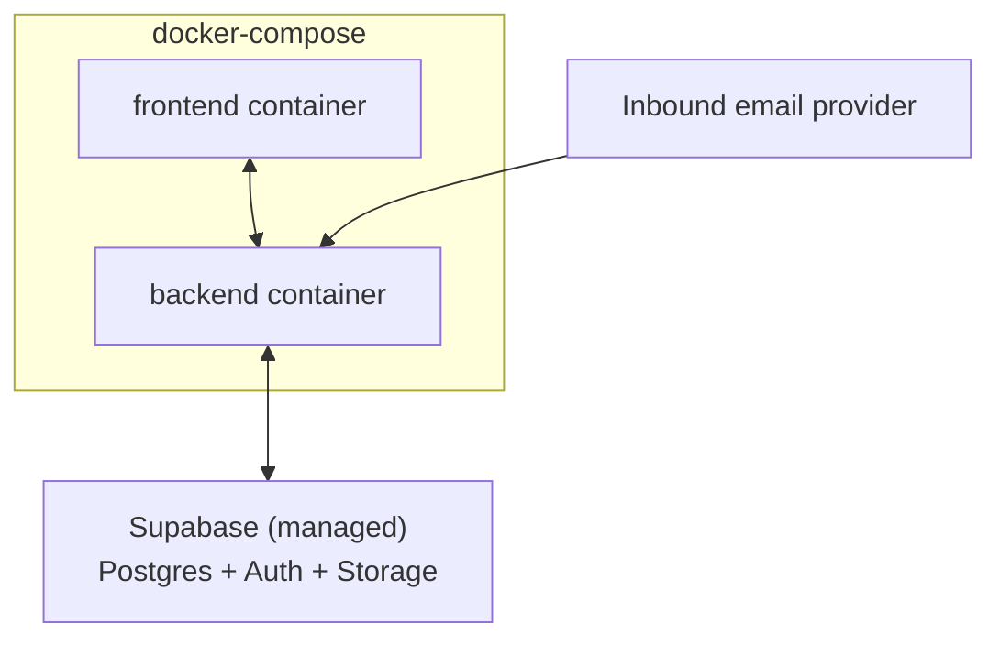

# PhishLens — System Architecture

A modular-monolith design for an explainable, email-forwarding phishing detector. Built to be shippable solo, with clean seams so any piece (ML inference, ingestion, async processing) can be pulled into its own service later without a rewrite.

---

## 1. Design Goals

- **One workflow, no forms**: the only user action is forwarding an email. Everything downstream is automatic.
- **Explainability is structural, not decorative**: SHAP output drives the explanation text directly — never a separate "guess why" step.
- **Train/serve parity**: the exact same feature-extraction code runs at training time and at inference time. This is the single most common way phishing classifiers silently break in production, so it's treated as a hard constraint, not a nice-to-have.
- **Synchronous first, async-ready**: v1 processes an email in the request path. The architecture reserves the seam (a queue) so Redis/Celery can be dropped in later without touching feature or model code.
- **Solo-developer buildable**: one FastAPI service internally organized into clear modules (ingestion / features / ml / explain / scoring), rather than several microservices from day one.

---

## 2. High-Level Architecture



Everything inside "FastAPI Backend" is one deployable service for v1 — the boxes are module boundaries in code, not separate containers.

---

## 3. Repository Structure

```text
phishlens/
├── backend/
│   ├── app/
│   │   ├── main.py                  # FastAPI app entrypoint
│   │   ├── api/                     # HTTP routers — thin, no business logic
│   │   │   ├── analyses.py
│   │   │   ├── auth.py
│   │   │   └── webhooks.py          # inbound-email endpoint
│   │   ├── ingestion/
│   │   │   ├── webhook_parser.py    # provider payload -> raw MIME
│   │   │   ├── gmail_client.py      # alt path, phase 4
│   │   │   └── email_parser.py      # MIME -> headers/body/urls/attachments
│   │   ├── features/                # ONE shared module, used by both API and training
│   │   │   ├── header_features.py
│   │   │   ├── url_features.py
│   │   │   ├── text_features.py
│   │   │   ├── action_features.py
│   │   │   ├── attachment_features.py
│   │   │   ├── behavioral_features.py
│   │   │   └── feature_vector.py    # assembles the final ordered vector
│   │   ├── ml/
│   │   │   ├── train.py             # offline training script
│   │   │   ├── artifacts/           # saved model files (joblib)
│   │   │   ├── registry.py          # loads active model by algorithm/version
│   │   │   └── infer.py
│   │   ├── explain/
│   │   │   ├── shap_engine.py
│   │   │   └── templates.py         # feature_name -> sentence template
│   │   ├── scoring/
│   │   │   └── risk_bands.py
│   │   ├── db/
│   │   │   ├── models.py
│   │   │   └── session.py
│   │   └── core/
│   │       ├── config.py
│   │       └── security.py          # Supabase JWT verification
│   ├── tests/
│   ├── Dockerfile
│   └── requirements.txt
├── frontend/
│   ├── src/
│   │   ├── pages/                   # Dashboard, AnalysisDetail, Login
│   │   ├── components/
│   │   ├── api/                     # typed fetch client
│   │   └── App.tsx
│   ├── Dockerfile
│   └── package.json
├── ml-notebooks/                    # model comparison, EDA — not shipped
├── docker-compose.yml
└── docs/
```

The `features/` package is imported by **both** `api/webhooks.py` (inference) and `ml/train.py` (training). That's the train/serve-parity constraint made concrete — there is no second copy of feature logic anywhere.

---

## 4. Component Breakdown

### 4.1 Email Ingestion

Two mechanisms were on the table; recommendation for v1:

| | Inbound email webhook (Postmark / Mailgun / SendGrid inbound parse) | Gmail API (watch + Pub/Sub push) |
|---|---|---|
| Setup complexity | Low — point MX/forwarding at provider, verify a webhook signature | Higher — OAuth consent screen, Pub/Sub topic, token refresh |
| Works for any sender's email provider | Yes | Yes (Gmail only reads the *bot's* inbox, sender can be anyone) |
| MIME parsing | Provider often pre-parses for you | You parse raw RFC 2822 yourself |
| **v1 recommendation** | ✅ start here | phase 4, if a Gmail-native experience is wanted |

**Flow**: provider POSTs the raw email to `/api/webhooks/inbound`, signature is verified, raw MIME is stored in Supabase Storage (for audit + reprocessing after a model update), then handed to `email_parser.py`, which extracts headers, plaintext/HTML body, URLs, and attachment metadata into a single `ParsedEmail` object.

### 4.2 Feature Extraction Engine

Each spec category becomes one small, independently testable module. All return a flat dict merged by `feature_vector.py` into the vector the model actually sees.

| Module | Example output features |
|---|---|
| `header_features` | `spf_pass`, `dkim_pass`, `dmarc_pass`, `from_reply_to_mismatch`, `display_name_domain_mismatch` |
| `url_features` | `url_count`, `has_link_text_mismatch`, `uses_url_shortener`, `domain_age_days`, `is_punycode`, `max_subdomain_depth` |
| `text_features` | `urgency_score`, `threat_language_score`, `contains_credential_request_phrase`, `readability_score` |
| `action_features` | `requests_credentials`, `requests_payment`, `requests_file_download`, `requests_link_click` |
| `attachment_features` | `has_attachment`, `attachment_count`, `has_executable_extension`, `has_macro_enabled_office_doc` |
| `behavioral_features` | `sender_seen_before`, `days_since_first_seen`, `deviation_from_sender_baseline`, `insufficient_history` (cold-start flag) |

Text/urgency scoring for v1 is a lexicon + simple classifier (fast, explainable, no extra infra) rather than a transformer — keeps SHAP's job simple and keeps inference latency low for the synchronous path.

### 4.3 Sender History Store

A `sender_profiles` table keyed by sender address, holding rolling stats (message count, average urgency score, typical sending domains, a lightweight text fingerprint). On each analysis: read the profile → compute deviation features → update the profile. Below a configurable message-count threshold, `behavioral_features` are computed but flagged `insufficient_history` so the explanation layer never claims false confidence from thin data.

### 4.4 ML Inference

`registry.py` loads whichever model version is marked `is_active` for the chosen algorithm; `infer.py` exposes a single `predict_proba(feature_vector) -> float`. Swapping the active model is a DB update, not a deploy.

### 4.5 Explainability (SHAP)

- **TreeExplainer** for Random Forest / XGBoost — exact, fast enough to run per-request synchronously.
- **LinearExplainer** if Logistic Regression ends up the selected model.
- A small cached background/reference sample (a few hundred rows) is kept in memory at startup so each request only pays for one explanation pass, not a full re-fit.
- SHAP runs **per prediction**, inline in the request — this is the part most likely to dominate latency, so it's the first candidate to move behind a queue if v1 synchronous timing gets tight.

### 4.6 Explanation Generator

Top-k features by absolute SHAP value are mapped through `templates.py`, e.g. `url_link_text_mismatch` → *"The visible link text doesn't match where it actually leads."* Only positive (risk-raising) contributors are surfaced as reasons by default; negative contributors are available for a future "why this wasn't flagged higher" view but aren't in the v1 UI.

### 4.7 Risk Scorer

Wraps the raw probability into a 0–100 score and a LOW/MEDIUM/HIGH band using thresholds pulled from config (not hardcoded), versioned alongside the model so past results stay explainable even after thresholds are retuned.

### 4.8 API Layer (FastAPI)

| Method | Path | Purpose |
|---|---|---|
| POST | `/api/webhooks/inbound` | Provider delivers a forwarded email |
| GET | `/api/analyses` | List the current user's past analyses |
| GET | `/api/analyses/{id}` | Full detail: score, band, reasons, extracted evidence |
| GET | `/api/analyses/{id}/raw` | Original headers/body (for the "show me the evidence" view) |
| POST | `/api/auth/link-sender` | Associate a bot-forwarded email's sender with the logged-in user (see note below) |

**Sample response — `GET /api/analyses/{id}`:**
```json
{
  "id": "8f2e...",
  "sender": "security@paypa1-support.com",
  "subject": "Your account will be suspended",
  "risk_score": 91,
  "risk_band": "HIGH",
  "reasons": [
    "The visible link text doesn't match where it actually leads.",
    "Sender information is inconsistent with how the message was actually delivered.",
    "The message pressures you to act immediately."
  ],
  "model_version": "xgboost-v3",
  "created_at": "2026-09-24T10:12:00Z"
}
```

> **Open design question worth deciding early**: since the bot receives email from an address that isn't necessarily the logged-in user's own inbox, you need a way to tie an incoming analysis back to a PhishLens account — e.g. a unique per-user forwarding alias (`u-8f2e@phishlens.app`), or requiring the user forward *from* their registered address. Pick one before building auth; it changes the ingestion endpoint's logic.

### 4.9 Frontend (React + TypeScript)

Three screens cover v1: **Dashboard** (list of past analyses with score/band), **Analysis Detail** (score, reasons, expandable raw evidence), **Login** (Supabase Auth UI). No settings screen needed until thresholds or forwarding-alias management become user-facing.

### 4.10 Auth

Supabase Auth issues a JWT on login; the frontend attaches it as a bearer token; FastAPI verifies it against Supabase's JWKS on every protected route. No custom session/password handling to build.

---

## 5. End-to-End Sequence



---

## 6. Database Schema



`FEATURE_VALUES` and `EXPLANATIONS` are deliberately narrow (name/value rows rather than one wide table) so adding a new feature module never requires a migration.

---

## 7. ML Pipeline & Model Lifecycle

1. `train.py` loads a labeled dataset (phishing + legitimate corpora), imports the **same** `features/` package the API uses, and produces one feature matrix.
2. Splits train/test, trains Logistic Regression, Random Forest, and XGBoost.
3. Evaluates each on F1-score and ROC-AUC, plus a confusion matrix for error inspection.
4. Best model is saved to `ml/artifacts/`, with a row written to `model_versions` (`is_active = true`, others flipped off).
5. `registry.py` picks up the active row on next backend restart (or via an admin-only "reload model" endpoint if you want zero-downtime swaps).

Retraining is manual for v1 — there's no scheduled job. The seam for one is `train.py` behind a cron/GitHub Action later, with no other code changes required.

**Datasets worth starting from**: the Nazario phishing corpus and PhishTank-sourced URLs for positive examples; the Enron corpus for legitimate mail. Split train/test *before* computing behavioral features, and split by sender where possible — otherwise a sender's messages can leak across the split and inflate behavioral-feature performance artificially.

---

## 8. Security & Privacy

- **Encrypt raw email storage at rest.** Forwarded emails are someone else's correspondence — treat `EMAIL_RAW` storage as sensitive by default.
- **Verify every inbound webhook signature.** An unauthenticated inbound endpoint is an open door to feed arbitrary content into your ML pipeline and storage.
- **Never open or execute attachments** — inspect only metadata (filename, extension, size, hash). Rendering attachment content is out of scope and a real risk surface.
- **Rate-limit the bot address** per sender/domain to prevent someone using it to run up inference costs.
- **Row-Level Security in Supabase** so a user's `ANALYSES` rows are only queryable by that user.
- **Scope Gmail OAuth tightly** (readonly, restricted to the bot's own inbox) if/when that path is built.
- **Define a retention policy** for raw email storage vs. the longer-lived feature/explanation records — you likely don't need to keep raw MIME as long as you keep the analysis result.

---

## 9. Deployment



Supabase is managed, so it's external to your Docker Compose stack, not a container you run. Backend and frontend ship as two Docker images. Hosting provider is genuinely open per your notes — Railway, Render, and Fly.io are the least-ceremony options for a two-container app with a managed DB; a single VM with Compose + Caddy is the cheapest if you want more control. GitHub Actions can build both images and deploy on push to `main`.

---

## 10. Scalability & the Async Path

v1 does everything in the webhook's request path. The trigger to introduce Redis + Celery is simple to observe: watch p95 latency from "webhook received" to "analysis stored." If SHAP + inference regularly push that past a few seconds, split it:

```
webhook receives → enqueue job (Redis) → return 202 immediately
Celery worker → parse, extract, infer, explain, store
Frontend → poll, or subscribe via Supabase Realtime for "analysis complete"
```

No feature, model, or explanation code changes — only the boundary between "received" and "processed" moves.

---

## 11. Browser Extension (Future)

A Manifest V3 content script reads the open message's DOM/headers in webmail and calls the *same* `/api/analyses` endpoint the forwarding workflow uses — same detector, same model, same explanations, just a second entry point. Requires the API to accept CORS from the extension's origin and to authenticate via the same Supabase JWT the user is already logged in with on the web app.

---

## 12. Testing Strategy

- **Per-module unit tests** for each `features/*` file, using fixture emails that are known-phishing and known-legitimate.
- **Integration test**: a mocked webhook payload run through the full pipeline, asserting a sane risk band on a small set of golden emails.
- **Model evaluation harness**: reports F1/ROC-AUC/confusion matrix per candidate model, run any time `train.py` changes.
- **SHAP sanity check**: verify that near-identical inputs produce stable top-feature rankings — a good early warning if a feature is noisy.

---

## 13. Phased Roadmap

| Phase | Scope |
|---|---|
| **0** | This architecture, repo scaffold, DB schema migration |
| **1 — MVP** | Inbound webhook (one provider), header + URL + text features only, Logistic Regression baseline, plain risk score (no SHAP yet), minimal frontend (list + detail) |
| **2** | Add Random Forest / XGBoost + model comparison, add SHAP + explanation templates, add attachment + behavioral modules, sender-history store |
| **3** | Supabase Auth wired in, per-user forwarding-alias decision resolved, threshold tuning, retention/security hardening |
| **4 — stretch** | Async processing (Redis/Celery), browser extension, Gmail API as an alternate ingestion path |

Phase 1 deliberately skips SHAP and two feature modules — a working end-to-end slice (however plain) surfaces integration problems (train/serve skew, ingestion auth, DB schema gaps) far earlier than building every module in isolation first.
