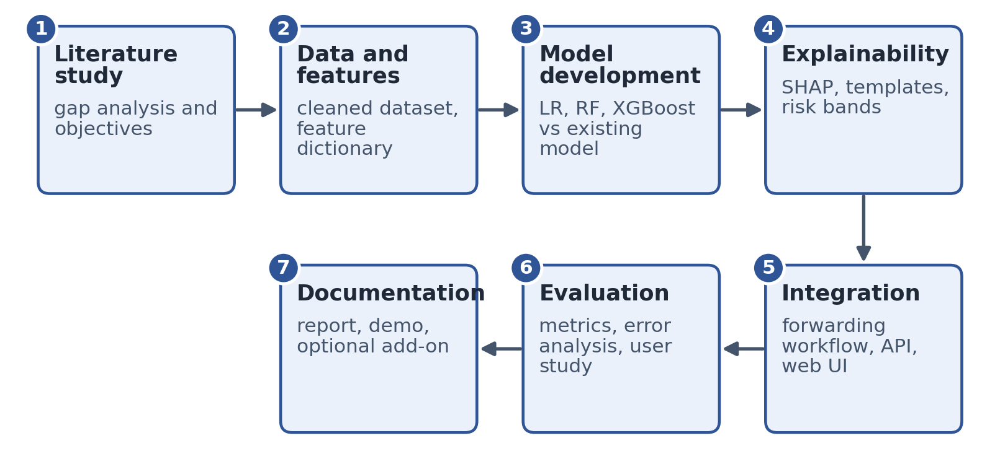
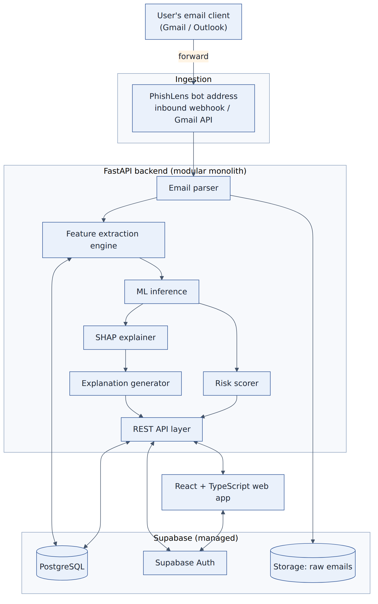
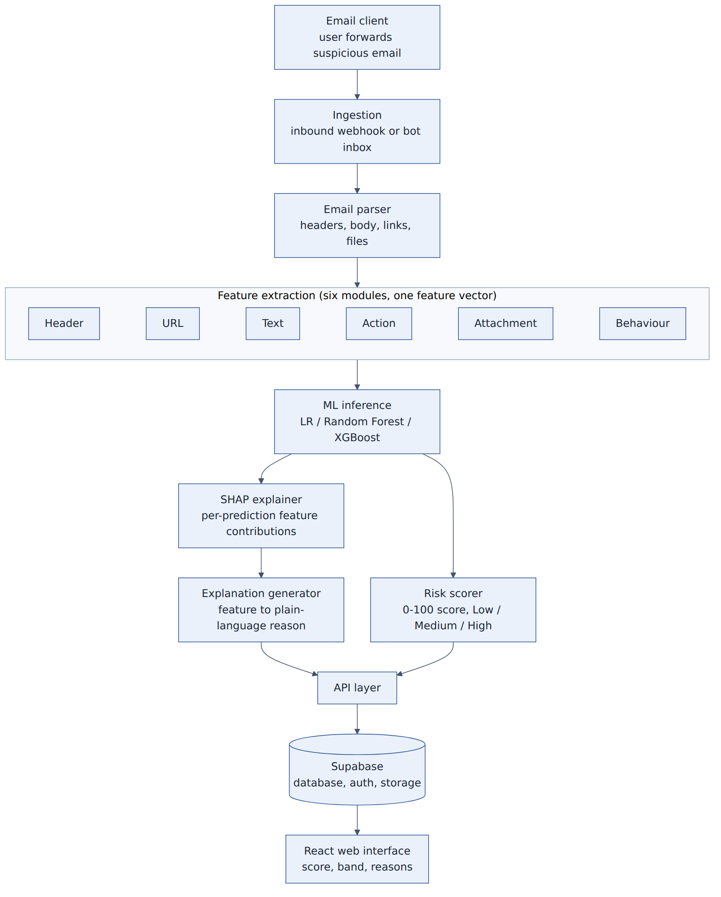
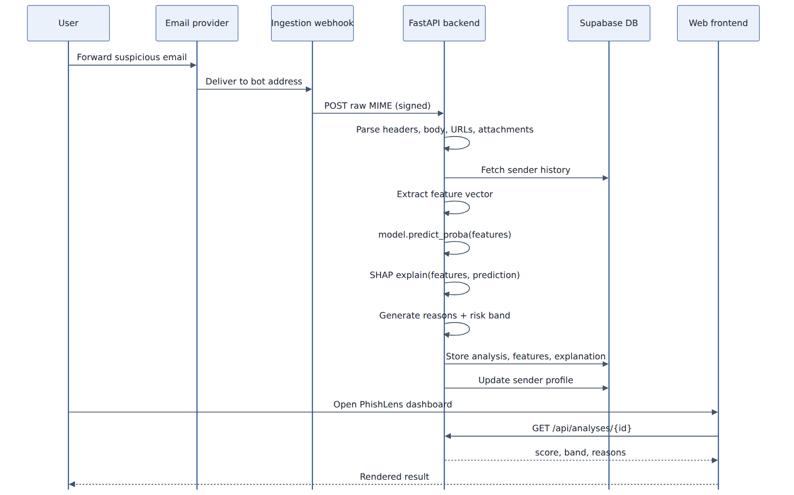
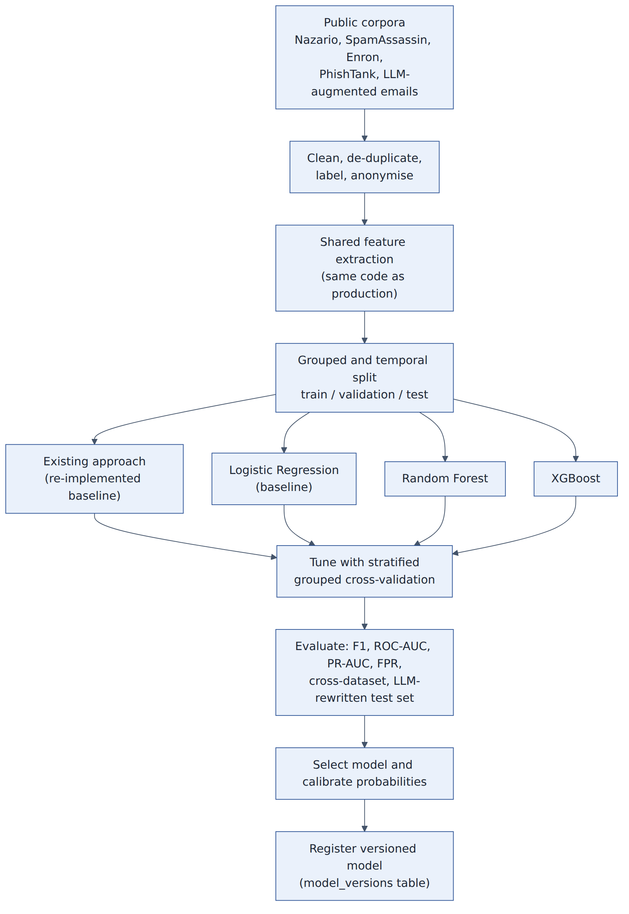
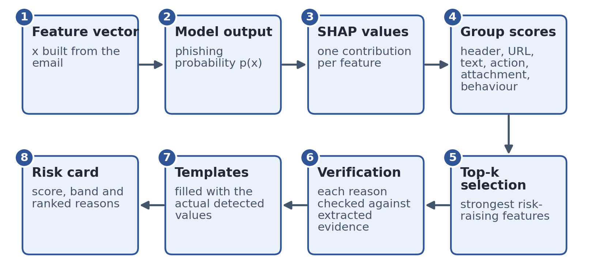

# 4. Proposed Methodology

## 4.1 Overall approach

The project follows an iterative, incremental approach. A thin end-to-end slice (email in, risk score and reasons out) is built first so that integration problems surface early, and each later increment adds evidence groups, models and explanation quality. The work proceeds through seven phases (Figure 1), each of which ends in a concrete output that the next phase consumes. The delivery increments that realise these phases are given in Section 4.20.

*Figure 1: Phases of the proposed methodology and the output of each phase*

## 4.2 System architecture

PhishLens is designed as a modular monolith: one deployable FastAPI service whose internal modules (ingestion, features, models, explanation, scoring) have clear boundaries, so that any module can later be moved into its own service without rewriting the others. The following principles guide the design.

- **One workflow, no forms.** The only user action is forwarding an email; everything downstream is automatic.
- **Explainability is structural.** SHAP output drives the explanation text directly; there is no separate step that guesses reasons after the fact.
- **Train and serve parity.** The same feature-extraction code is imported by the training scripts and by the API. Feature logic is never written twice, which prevents the silent train-serve skew that commonly degrades deployed classifiers.
- **Synchronous first, asynchronous ready.** Version 1 processes an email within the request. A queue (Redis with Celery) can later be placed between "received" and "processed" without changing feature, model or explanation code.
- **Buildable by a small team.** One service, a managed database and two containers keep operations manageable.

*Figure 2: High-level architecture of PhishLens*

Figure 3 expands the backend into the processing pipeline. Six feature-extraction modules produce a single feature vector that feeds the model; the prediction then splits into two branches, one that explains it (SHAP and the explanation generator) and one that converts it into a risk score and band. Both branches are returned through the API layer and stored in the database.

*Figure 3: Detailed processing pipeline from forwarded email to displayed result*

**Table 6: Components and their responsibilities**

| Component | Responsibility | Technology |
|---|---|---|
| Ingestion | Receive the forwarded email at the bot address; verify the sender of the webhook; hand over raw MIME | Inbound email webhook provider (or Gmail API) |
| Email parser | Convert MIME into headers, text, links (with anchor text) and attachment metadata | Python email library |
| Feature extraction engine | Six modules (header, URL, text, action, attachment, behaviour) produce one ordered feature vector | Python, scikit-learn utilities |
| Sender history store | Keep rolling statistics per sender for behavioural features | PostgreSQL (Supabase) |
| ML inference | Load the active model version and return a phishing probability | scikit-learn, XGBoost |
| SHAP explainer | Compute per-prediction feature contributions | SHAP (TreeExplainer or LinearExplainer) |
| Explanation generator | Select top contributors, verify them against evidence and fill sentence templates | Python (rules and templates) |
| Risk scorer | Convert the calibrated probability into a 0 to 100 score and a Low, Medium or High band | Python, versioned configuration |
| API layer | Expose analyses to the web interface; validate authentication tokens | FastAPI |
| Database, storage, authentication | Persist analyses, features, explanations, model versions and raw emails; manage users | Supabase PostgreSQL, Storage, Auth |
| Web interface | Show score, band, reasons, evidence and history | React with TypeScript |

## 4.3 End-to-end data flow

Figure 4 shows the sequence of events for one email. The numbered steps below summarise it.

*Figure 4: Sequence of events from forwarding an email to viewing the result*

1. The user receives a suspicious email and forwards it to the PhishLens bot address using the normal Forward or Share action.
2. The email provider delivers it to the ingestion webhook, which posts the raw message to the backend with a verifiable signature.
3. The backend stores the raw message, parses it and fetches the sender's profile from the database.
4. The six feature modules produce one feature vector; unavailable evidence is encoded as an explicit missing indicator.
5. The model returns a phishing probability, which is calibrated and converted into a score and a risk band.
6. SHAP computes feature contributions; the explanation generator selects, verifies and phrases the top reasons.
7. The analysis, features and reasons are stored, and the sender profile is updated.
8. The user opens the web interface and reads the score, band and reasons.

## 4.4 Data collection and preparation

Training and evaluation data are assembled from public sources and supplemented with project-collected samples. Table 7 lists the planned sources and how each is used.

**Table 7: Planned data sources**

| Source | Content | Role in the project | Notes |
|---|---|---|---|
| Nazario phishing corpus [33] | Phishing emails collected over several years | Positive class for email-level models | Older campaigns; checked for dating and leakage |
| Apache SpamAssassin public corpus [34] | Legitimate (ham) and spam emails | Negative class; spam kept as a separate hard-negative label | Spam is not the same as phishing |
| Enron corpus [32] | Legitimate corporate email with sender histories | Negative class and source of sender histories for behavioural tests | Dated (early 2000s); used for structure, not for current style |
| PhishTank [35] | Community-verified phishing URLs | URL-feature training and validation, paired with benign popular-domain URLs | Verified entries only |
| LLM-rewritten and LLM-generated sets [10], [12] | Original and LLM-rephrased phishing emails | Robustness test and augmentation, subject to licence | Used mainly for testing, not only for training |
| Project-collected samples | Consented, anonymised forwarded emails and synthetic examples | End-to-end tests and demonstrations | No personal data retained |

Preparation follows a fixed sequence so that the same steps can be repeated for every new source:

1. parse each message with the production parser, so training data pass through the same code path as live data;
2. decode text, convert HTML to plain text and normalise URLs;
3. remove exact and near-duplicate messages (content hash plus similarity hashing) so that copies do not appear in both training and test sets;
4. remove artefacts that reveal the label without describing the message, such as corpus-specific footers or file-name patterns;
5. anonymise personal identifiers in any project-collected sample;
6. label and cross-check a random sample manually to estimate label noise.

**Splitting strategy.** To avoid optimistic results, data are split by sender domain or campaign group and, where dates are available, in time order. In addition, models trained on one corpus are tested on another (cross-dataset evaluation), which is the practice recommended by Yi et al. [13] and motivated by Mia et al. [23]. A held-out test set keeps a realistic, imbalanced class ratio, while training uses class weights or resampling to handle imbalance.

**Behavioural benchmark.** Public phishing corpora do not contain the victim's earlier mail from the same sender. Behavioural features are therefore evaluated on a semi-synthetic benchmark: Enron sender histories provide realistic "normal" behaviour, and phishing or LLM-written messages are injected under known sender identities (spoofed, look-alike or compromised-account scenarios). The limitations of this approach are stated openly in Section 5.5.

**Ethics and privacy.** No personal data from third parties are used for training. Participants in the user study give informed consent, and forwarded emails stored by the running system are encrypted at rest and removed after a defined retention period (Section 4.15).

## 4.5 Email ingestion and parsing

Two ingestion mechanisms were considered. Table 8 compares them; an inbound-email webhook provider is chosen for version 1 because it needs less setup, and the Gmail API remains an alternative for a later increment.

**Table 8: Comparison of ingestion mechanisms**

| Aspect | Inbound email webhook (Postmark, Mailgun, SendGrid) | Gmail API with push notifications |
|---|---|---|
| Setup effort | Low: point forwarding at the provider and verify a webhook signature | Higher: OAuth consent, Pub/Sub topic, token refresh |
| Sender providers supported | Any provider; the user forwards from anywhere | Any sender; only the bot's own inbox is read |
| MIME handling | Provider often pre-parses fields; raw MIME can be requested | Raw RFC 5322 message must be parsed by the application |
| Decision for version 1 | Selected | Later increment |

**Forwarded-message handling.** The parser distinguishes two forms. A message forwarded as an attachment contains the original message (type message/rfc822) with its headers intact, and is analysed directly. For an inline forward, the parser locates the quoted original header block (From, Date, Subject, Reply-To) in the body and uses it for sender-consistency features; authentication results of the original delivery cannot be recovered, so SPF, DKIM and DMARC features are marked as missing. The interface advises users to choose "Forward as attachment" when their client supports it.

**Linking analyses to accounts.** Because the bot inbox is not the user's own mailbox, each registered user receives a unique forwarding alias (for example u-8f2e@phishlens.example), so incoming messages are tied to the correct account without asking the user to type anything.

**Safe parsing.** The parser extracts headers (including Authentication-Results, Received, From, Reply-To and Return-Path), the plain-text and HTML bodies, every link with its visible anchor text and actual destination, and attachment metadata (file name, declared type, size and SHA-256 hash). Attachment contents are never opened, rendered or executed.

## 4.6 Feature engineering

Each of the six evidence groups is implemented as a small, independently testable module that returns a flat set of features. The modules are merged by one function into the ordered vector seen by the model. Table 9 lists representative features; the final dictionary, with extraction rules and missing-value handling, is an output of Objective 1. The candidate set is expected to contain about 50 features, which will be pruned using SHAP and ablation results.

**Table 9: Representative feature dictionary**

| Group | Feature | Type | Description |
|---|---|---|---|
| Header and sender | spf_result, dkim_result, dmarc_result | Category | Verification results from Authentication-Results [29], [30], [31]; "missing" when not recoverable |
|  | from_replyto_mismatch | Binary | Reply-To domain differs from the From domain |
|  | from_returnpath_mismatch | Binary | Return-Path domain differs from the From domain |
|  | display_name_brand_mismatch | Binary | Display name claims a known brand or person but the domain does not match |
|  | sender_domain_age_days | Numeric | Age of the sender domain from registration data (missing flag if unavailable) |
| URL | url_count, unique_domain_count | Numeric | Number of links and distinct destination domains |
|  | link_text_mismatch | Binary | Visible link text shows one domain while the link opens another |
|  | ip_in_host, uses_shortener, punycode | Binary | Numeric host, URL shortener or internationalised look-alike characters |
|  | subdomain_depth, url_length, special_char_ratio | Numeric | Structural properties of the destination URL |
|  | brand_in_subdomain_or_path | Binary | Brand name placed outside the registered domain |
|  | landing_domain_age_days | Numeric | Age of the destination domain |
| Language and tone | urgency_score, threat_score | Numeric | Pressure and threat language from a lexicon plus a small classifier |
|  | credential_phrase_flag | Binary | Phrases asking to verify, confirm or re-enter account details |
|  | financial_terms_ratio, caps_exclaim_ratio | Numeric | Share of money-related terms; capitals and exclamation marks |
| Requested action | requests_click, requests_credentials, requests_payment, requests_download, requests_reply_info | Binary | What the sender asks the reader to do, from rules and a classifier |
| Attachment | has_attachment, attachment_count | Binary / numeric | Presence and number of attachments |
|  | risky_extension, double_extension | Binary | Executable or script types; names such as invoice.pdf.exe |
|  | macro_enabled_office, mime_extension_mismatch | Binary | Macro-enabled documents; declared type differs from file extension |
| Sender behaviour | sender_seen_before, prior_message_count, days_since_first_seen | Binary / numeric | Familiarity of this sender to the recipient system |
|  | new_sending_domain, replyto_changed, new_link_domain | Binary | Domain, Reply-To or link domain never seen in this sender's history |
|  | urgency_deviation, text_style_distance, send_time_deviation | Numeric | Deviation from the sender's baseline (Equations 1 and 2) |
|  | insufficient_history | Binary | Cold-start flag when too few earlier messages exist |

**Behavioural features.** For each sender s, the system keeps rolling statistics: the message count, the mean and standard deviation of numeric features such as urgency, the set of sending and link domains seen, and the centroid of a text representation (TF-IDF or a sentence embedding). For a new message with numeric feature value x and text representation e, the deviation measures are:

> `z = (x − μₛ) / σₛ`  *(1)*

> `d_cos = 1 − (e · ēₛ) / (‖e‖ ‖ēₛ‖)`  *(2)*

where μₛ and σₛ are the sender's mean and standard deviation and ēₛ is the sender's text centroid. After analysis the profile is updated with an exponential moving average, so that it follows slow changes in the sender's habits. Below a configurable number of earlier messages the deviation features are still computed but the insufficient_history flag is set, and the explanation layer is not allowed to claim a behavioural reason from thin data. Language features are one category among several, because wording alone is not trusted in the era of LLM-written phishing [9], [10].

## 4.7 Model development

Three machine-learning models are developed on the shared feature vector and compared against an existing approach (Table 10 and Figure 5). The comparison with an existing approach implements the second objective: a published pipeline is re-implemented (for example the URL-feature random forest or XGBoost pipeline of [13], and optionally a fine-tuned DistilBERT text classifier in the style of [15]) and evaluated on exactly the same splits as the proposed model.

**Table 10: Candidate models**

| Model | Role | Rationale | Main hyperparameters tuned |
|---|---|---|---|
| Logistic regression | Transparent baseline | Shows how much performance comes from the features; well-calibrated probabilities | Regularisation strength, penalty, class weight |
| Random forest [19] | Non-linear ensemble | Robust to noisy features; strong cross-dataset behaviour reported [13] | Trees, depth, minimum leaf size, class weight |
| XGBoost [18] | Boosted trees | Strong on tabular data [20]; exact fast SHAP [17] | Learning rate, depth, trees, subsample, column sample, positive-class weight |
| Existing approach (re-implemented) | Comparison | Required by Objective 2; run on the same splits and metrics | As published |

*Figure 5: Offline model development and evaluation workflow*

Models are tuned with stratified, group-aware k-fold cross-validation (k = 5) using randomised search followed by a narrower refinement, with scikit-learn [36] and XGBoost. Probabilities are calibrated (Platt scaling or isotonic regression) and checked with reliability curves and the Brier score, because the displayed percentage is meant to be read as a risk estimate. The final model is selected by the highest macro F1-score subject to a ceiling on the false-positive rate on legitimate mail; ties are resolved in favour of the faster and simpler model. The chosen model is saved as a versioned artefact together with its metrics, and a row is written to the model_versions table.

## 4.8 Evaluation methodology

The models and the complete system are evaluated with the measures in Table 11, where TP, TN, FP and FN denote true positives, true negatives, false positives and false negatives, with phishing as the positive class.

**Table 11: Evaluation measures**

| Measure | Definition | Purpose |
|---|---|---|
| Accuracy | (TP + TN) / (TP + TN + FP + FN) | Overall correctness; reported but not used alone because classes are imbalanced |
| Precision | TP / (TP + FP) | Share of flagged emails that are truly phishing |
| Recall | TP / (TP + FN) | Share of phishing emails that are caught |
| F1-score | 2 · Precision · Recall / (Precision + Recall) | Balance of precision and recall; macro average over classes |
| False-positive rate | FP / (FP + TN) | Harm to legitimate mail; kept below a ceiling |
| ROC-AUC and PR-AUC | Area under the ROC curve and under the precision-recall curve | Threshold-independent ranking quality; PR-AUC suits imbalance |
| Brier score | Mean of (p − y) squared | Quality of the probability estimate |

**Table 12: Planned experiments**

| ID | Experiment | Purpose |
|---|---|---|
| E1 | Proposed models against the existing baseline on identical splits | Objective 2; model selection |
| E2 | Cross-dataset testing: train on one corpus, test on another | Generalisation [13], [23] |
| E3 | Temporal split: train on earlier, test on later data | Robustness to change over time |
| E4 | Test on LLM-rewritten and LLM-generated phishing | Robustness to generative AI [10], [12] |
| E5 | Ablation: remove one feature group at a time | Value of each evidence group, including behaviour and attachments |
| E6 | Error analysis of false positives and false negatives | Objective 4; taxonomy of failures |
| E7 | Explanation faithfulness: deletion test and stability of top reasons | Objective 3 |
| E8 | Latency per email and per pipeline stage | Feasibility of synchronous processing |

Differences between models are reported with bootstrap 95% confidence intervals, and paired predictions are compared with McNemar's test. The error analysis classifies false negatives (for example, well-written LLM phishing, compromised senders, very short messages) and false positives (for example, legitimate marketing mail with shortened links, automated notifications, messages from unfamiliar but genuine senders) so that remaining weaknesses are described rather than hidden.

## 4.9 Explainability module

SHAP attributes a prediction to its features using Shapley values. For a model f and feature set F, the contribution of feature i is

> `φᵢ = Σ over S ⊆ F∖{i} of [ |S|! (|F| − |S| − 1)! / |F|! ] · [ f(S ∪ {i}) − f(S) ]`  *(3)*

and the contributions are additive: the prediction for an input x equals a base value φ₀ plus the sum of the feature contributions [16]:

> `f(x) = φ₀ + Σᵢ φᵢ`  *(4)*

For random forest and XGBoost, the exact Tree SHAP algorithm is used [17]; for logistic regression a linear explainer is used. A small background sample is kept in memory at start-up, so each request pays only for one explanation pass. Explanations are produced for the individual prediction (local explanation); global summaries over the test set are used only during development to validate the model and prune features.

*Figure 6: From model output to verified plain-language reasons*

The conversion from SHAP values to text follows five rules:

1. Contributions are summed within each feature group, so that several correlated features (for example three URL features) are reported as one reason rather than three.
2. Only features that push the prediction towards phishing, and whose contribution exceeds a minimum, become reasons; protective features can be shown in a later "why it was not higher" view.
3. At most five reasons are shown, ordered by contribution, with at most one reason per group before any group is repeated.
4. Each candidate reason is checked against the evidence extracted from the email (for example, that the shown and actual link domains really differ); a reason without supporting evidence is discarded.
5. The reason is produced by filling a template with the real values found in the message (Table 13). Reasons from sparse behavioural history are suppressed when the cold-start flag is set.

**Table 13: Template catalogue (excerpt)**

| Feature or group | Template sentence |
|---|---|
| link_text_mismatch | The link text shows {shown_domain}, but the link actually opens {actual_domain}. |
| spf, dkim, dmarc failed | The sender's domain could not be verified as authorised to send this message ({failed_checks} failed). |
| from_replyto_mismatch | Replies would go to {reply_domain}, which differs from the sender address {from_domain}. |
| urgency_score high | The message pressures you to act quickly (for example "{phrase}"). |
| requests_credentials | The message asks you to enter or confirm your login details. |
| requests_payment | The message asks you to make or approve a payment. |
| landing_domain_age_days low | The website behind the link was registered only {n} days ago. |
| ip_in_host | A link uses a numeric address instead of a normal website name. |
| risky_extension | The attachment {filename} is a type of file that can run code. |
| behavioural deviation | This message differs from earlier messages from this sender: {detail}. |

Version 1 uses no LLM in the explanation path. This keeps every sentence traceable to a detected feature, avoids hallucinated statements, which were observed in unconstrained LLM-generated warning text [25], and keeps latency and cost low. Counterfactual phrasing ("this would look safer if the link text matched the real address") and LLM-based rewording of the verified facts are listed as optional extensions, because the user study of Cau et al. found that explanation style changes behaviour [25].

