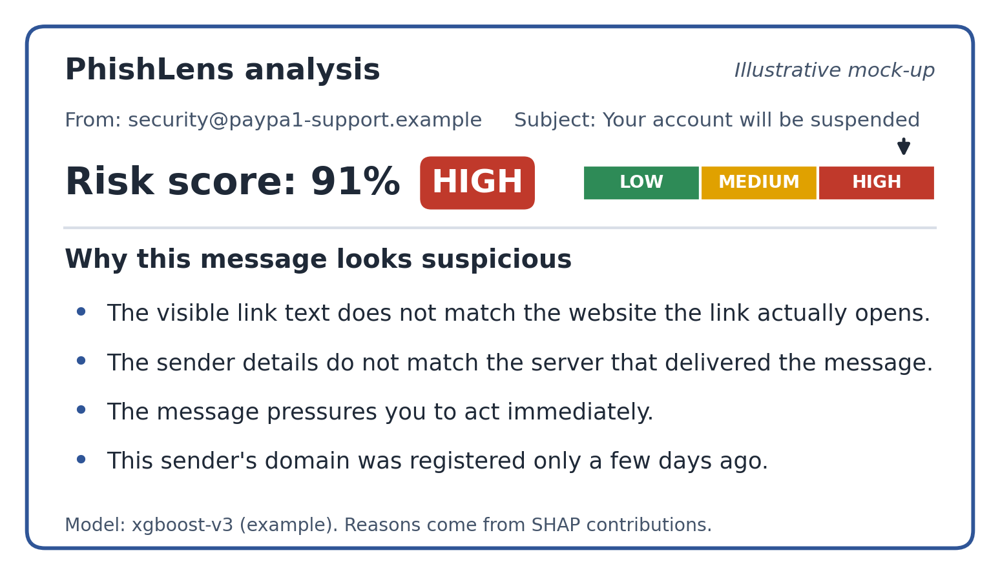
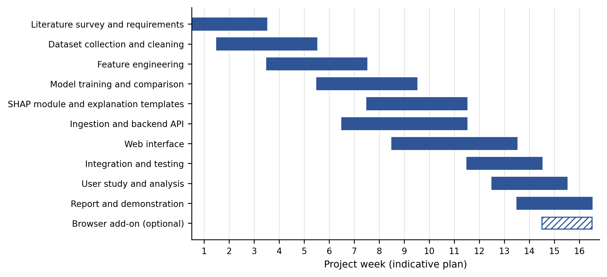

# 4 (continued). Proposed methodology - implementation view, then Expected outcomes and Conclusion

*Summary draft: each subsection points to the detailed design document in this repository.*

## 4.10 Risk scoring and bands
Calibrated probability p -> score = round(100 p) -> LOW / MEDIUM / HIGH with provisional thresholds 29 / 70 (configurable), selected finally on validation data
(HIGH precision >= 0.95, MEDIUM+HIGH recall >= 0.98 as starting rules). Each band has user guidance ("Do not click links, open files or reply. Report and delete it." for HIGH). -> [08](../08-ml-pipeline.md)

## 4.11 Backend and API design
FastAPI service; endpoints for upload, baseline, list/detail/features/delete, alias, model info, webhook; Supabase JWT verification; ownership checks. -> [05](../05-backend-design.md), [10](../10-api-reference.md)

## 4.12 Data model
Seven tables (analyses, email_raw, feature_values, explanations, model_versions, sender_profiles, user_aliases); narrow name/value rows so features can be added without migrations; RLS on Supabase. -> [07](../07-data-model.md)

## 4.13 Frontend
React + TypeScript: dashboard, analysis detail (reasons, evidence, SHAP table), settings (alias, known-good upload, model info), login. Illustrative result screen:  (mock-up) and real screenshots in [06](../06-frontend-design.md).

## 4.14 Deployment and scalability
Docker (frontend + backend containers), managed Supabase, inbound-email provider webhook; synchronous now, Redis + Celery when latency demands. -> [12](../12-deployment.md)

## 4.15 Security and privacy
Shared-secret webhook, never opening attachments, per-user isolation, retention and deletion, poisoning guard for sender history, encryption-at-rest to do. -> [11](../11-security-privacy.md)

## 4.16 Browser add-on (optional)
A Manifest V3 content script reads the open message in webmail and calls the same `/api/analyses` endpoint (same detector, same explanations), authenticated with the same Supabase token; the API needs CORS for the extension origin.

## 4.17 User evaluation
Between-subjects study (label only vs label + reasons), 20-30 emails, accuracy/time/confidence/Likert, non-parametric tests. -> [14](../14-user-study.md)

## 4.18 Testing strategy
Unit tests per module, integration tests of the pipeline and API, golden sample emails, evaluation experiments E1-E8. -> [13](../13-testing-and-evaluation.md)

## 4.19 Tools and technologies
| Area | Tools |
|---|---|
| Frontend | React, TypeScript, Vite, Supabase client |
| Backend | Python 3.12, FastAPI, Uvicorn, SQLAlchemy |
| ML | scikit-learn, XGBoost (CPU), NumPy, joblib |
| Explainability | SHAP, rule/template engine |
| Data/Auth | Supabase PostgreSQL, Supabase Auth |
| Email | inbound webhook provider (or Gmail API) |
| Dev/test | Git/GitHub, pytest, GitHub Actions, Docker, Postman |

## 4.20 Project plan

Increments: 1 MVP slice (done in v0.1) -> 2 real data and evaluation -> 3 real ingestion and accounts -> 4 user study -> 5 stretch goals. -> [03](../03-plan-and-roadmap.md)

## 4.21 Project risks and mitigation
Real-data performance below targets; dated/biased corpora; inbound email setup delays; misleading explanations; user-study delays; time. -> [15](../15-risks-and-limitations.md)

---

# 5. Expected outcomes

## 5.1 Deliverables
1. Working prototype: forward an email (or upload .eml), receive score, band and verified reasons in the web interface.
2. Documented dataset and 57-feature dictionary across six evidence groups.
3. Comparison of an existing approach with LR, RF and XGBoost on F1, ROC-AUC, PR-AUC, FPR, calibration, error analysis.
4. SHAP-based explanation module with evidence verification and a template catalogue.
5. User-study results on whether explanations help.
6. Report, slides, demo; optional browser add-on.

## 5.2 Planned measurable targets (to be validated, not results)
| Outcome | Metric | Planned target |
|---|---|---|
| Detection quality | macro F1 / ROC-AUC on held-out real test set | macro F1 >= 0.95, ROC-AUC >= 0.98 (revise if data show otherwise) |
| False alarms | FPR on legitimate mail | <= 2% (HIGH band precision >= 0.95) |
| Generalisation | F1 drop cross-dataset vs in-dataset | <= 5 percentage points |
| LLM-era robustness | recall on LLM-rewritten phishing | >= 0.90 |
| Explanation coverage | MEDIUM/HIGH emails with >= 2 verified reasons | >= 90% |
| Latency | p95 end-to-end per email (synchronous) | <= 5 s on a development server |
| User benefit | accuracy, reasons vs label only | >= 10 percentage points (hypothesis informed by Wagner et al. 2025) |

## 5.3 Expected contributions
Engineering: a reusable forward-and-explain pipeline with train/serve parity and verified explanations. Research/education: multi-signal feature set, cross-dataset and LLM-era evaluation on a small scale, and a user-study protocol; all documented for reuse.

## 5.4 Impact (SDG 9: targets 9.1, 9.c, 9.5)
Safer use of digital communication for people without a security team; openly documented method for other students and researchers.

## 5.5 Anticipated limitations and future work
English only; no image/QR analysis; public corpora are old; forwarding changes headers; behavioural history is sparse; explanation quality vs fidelity. Future: browser add-on, async processing, Gmail API ingestion, counterfactual and LLM-worded explanations (verification-gated), multilingual support, mailbox connector for trusted history.

---

# 6. Conclusion
PhishLens aims to show that phishing detection can be accurate **and** understandable: a forwarded email is checked on six evidence groups, scored, and explained with SHAP-based reasons that are verified against the email. v0.1 implements the complete pipeline end to end; the remaining work is honest evaluation on real data, real ingestion and a user study.
